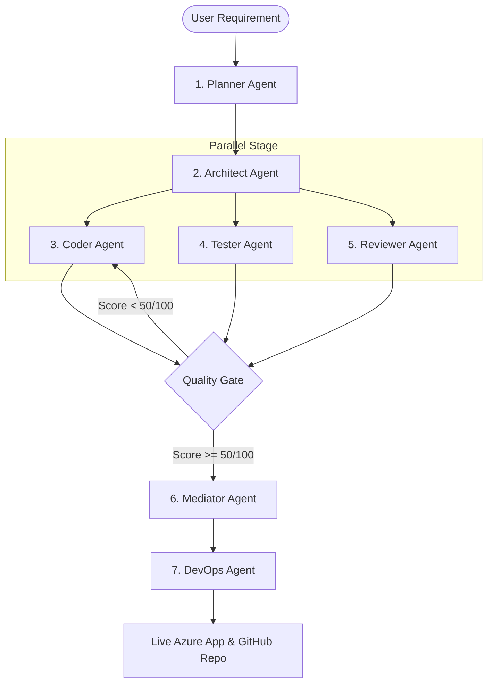

# Swarm Factory 🤖🏭

> Type a requirement. Get a working codebase. Deployed and tested in minutes.

Built for the **Microsoft Build AI Hackathon 2026 — Theme 05: Agent Swarms**.

---

## 📖 Overview

Swarm Factory is an autonomous multi-agent platform that translates plain-English requirements into fully deployed, production-ready codebases. By leveraging a coordinated swarm of **7 specialized AI agents**, it handles planning, design, coding, testing, review, and DevOps pipeline setup completely autonomously.



### The 7-Agent Pipeline

| Agent | Role | Focus | Model Configuration |
|---|---|---|---|
| **Planner** | Task Decomposer | Breaks requirements into an ordered task graph (DAG). | GPT-4o (`temp=0.2`) |
| **Architect** | Stack Designer | Designs tech stack, directory structure, and API contracts. | GPT-4o (`temp=0.2`) |
| **Coder** | Software Engineer | Writes all application and source code. | GPT-4o (`temp=0.2`) |
| **Tester** | QA Engineer | Writes unit & integration test suites. | GPT-4o (`temp=0.2`) |
| **Reviewer** | Security Auditor | Reviews code for security (OWASP Top 10), lint, and best practices. | GPT-4o (`temp=0.2`) |
| **Mediator** | Conflict Resolver | Resolves code merge conflicts and enforces the Quality Gate. | GPT-4o (`temp=0.2`) |
| **DevOps** | System Deployer | Sets up Docker, GitHub actions CI/CD, and deploys to Azure. | GPT-4o (`temp=0.2`) |

---

## 🛠️ Microsoft Stack & Technologies

*   **Azure OpenAI**: Powering the multi-agent orchestration (utilizing `gpt-4o` as primary, `phi-4` as secondary fallback, and `gpt-4o-mini` as tertiary fallback).
*   **AutoGen**: Orchestrates multi-agent group conversations.
*   **Semantic Kernel**: Implements the memory layer and handles embeddings.
*   **Azure AI Search**: Acts as the high-performance vector store for long-term session memory.
*   **Azure Container Apps & Container Registry (ACR)**: Hosts the backend and manages Docker containers.
*   **GitHub Actions**: Powers the autonomous CI/CD pipelines.

---

## 🚀 Quick Start (Local Development)

### Layout

```
apps/platform-core/zolexora-ai/
  apps/web/            React + Vite dashboard (also bundled into the API image)
  services/api/        FastAPI + Celery service
    backend/           Python package (api, agents, orchestrator, memory, tools, models, core, job_queue)
    main.py            uvicorn entry point
    requirements.txt
    tests/
    Dockerfile         API image (repo root build context)
  infra/azure/         Azure Bicep templates
  scripts/             Azure provisioning / deploy / memory seeding
  compose.yaml         Local Docker stack (redis, backend, celery, frontend, nginx)
```

### 1. Prerequisites

Python 3.11+, Node 20+, Docker, the Infisical CLI. Secrets come only from Infisical
(`/Zolexora_AI`, see `.infisical.json`); there is no `.env` file.

```bash
infisical login
pip install -r services/api/requirements.txt
(cd apps/web && npm install)
```

### 2. Run without Docker

Run from `apps/platform-core/zolexora-ai`:

```bash
W="bash ../../../scripts/setup/with-infisical.sh ."
docker run -d -p 6379:6379 --name redis redis:alpine
(cd services/api && $W celery -A backend.celery_app worker --loglevel=info)   # terminal 1
(cd services/api && $W uvicorn main:app --reload --port 4090)               # terminal 2
(cd apps/web && npm run dev)                                                 # terminal 3
```

## 🐳 Running with Docker

```bash
# from apps/platform-core/zolexora-ai
bash ../../../scripts/setup/with-infisical.sh . docker compose up -d
docker compose logs -f backend      # or celery, frontend, redis
```

Images build from the repo root (`docker build -f apps/platform-core/zolexora-ai/services/api/Dockerfile .`).
Backend: http://localhost:4090 · Gateway: http://localhost:3091 (see `docs/ports.md`).

### Frontend Vite dev proxy

Leave `VITE_API_BASE_URL`, `VITE_API_URL`, `VITE_WS_BASE_URL` and `VITE_WS_URL` empty in local dev:
Vite proxies `/api` and `/ws` to the backend on `localhost:4090`. Set them only when the frontend is
deployed separately (use `wss://...` for the WebSocket URLs). `VITE_API_KEY` is sent as `X-API-Key`
and must match the backend `API_KEY` stored in Infisical.

---

## ☁️ Azure Infrastructure Provisioning

Swarm Factory requires a few Azure resources to deploy generated applications to the cloud. You can set them up using either the automated script or the legacy manual CLI commands.

### Method 1: Automated Script (Recommended)
This script registers all required resource providers, provisions Azure resources, and prints the endpoints and keys to store in Infisical.

```bash
# Run the automated setup script
bash scripts/setup-azure-resources.sh
```

**What the script provisions:**
1.  Resource Group: `swarm-factory-rg`
2.  Azure OpenAI: `swarm-factory-openai` (with `gpt-4o` and `gpt-4o-mini` deployments)
3.  Azure AI Search: `swarm-factory-search` (basic SKU)
4.  Azure Container Registry (ACR): `swarmfactoryacr`
5.  Azure Container Apps Environment: `swarm-factory-env`

---

### Method 2: Manual CLI Setup (Legacy / Alternative)
If you prefer to configure resources manually or need fine-grained control over the creation process, run these Azure CLI commands:

```bash
# 1. Login to Azure
az login

# 2. Register required resource providers
az provider register --namespace Microsoft.App --wait
az provider register --namespace Microsoft.ContainerRegistry --wait

# 3. Create the Resource Group
az group create --name swarm-factory-rg --location eastus

# 4. Create the Azure Container Registry (ACR)
az acr create \
  --name swarmfactoryacr \
  --resource-group swarm-factory-rg \
  --sku Basic \
  --admin-enabled true

# 5. Create the Container Apps Environment
az containerapp env create \
  --name swarm-factory-env \
  --resource-group swarm-factory-rg \
  --location eastus
```

> [!NOTE]
> If you deploy manually, store the resource endpoints, keys and IDs in Infisical (`Zolexora_AI` folder).

---

## 🚢 Deploying to Azure

Once your Azure resources are provisioned and their keys are in Infisical, you can build and deploy the Swarm Factory application to production:

```bash
# Run the deployment script
bash scripts/deploy-azure.sh
```

This script:
1.  Builds the API image (which bundles the React frontend from `apps/web`) using `services/api/Dockerfile` with the repo root as context.
2.  Pushes the container image to your Azure Container Registry (ACR).
3.  Deploys or updates the Azure Container App hosting the backend API.
4.  Outputs the live URL of your deployment (e.g. `https://swarm-factory-api.azurecontainerapps.io`).

---

## 🤝 Contributing & Disclaimers

This project was developed using **GitHub Copilot** as an AI coding assistant, in compliance with the hackathon rules.

For a detailed walkthrough of the internal components and data schemas, please refer to [ARCHITECTURE.md](ARCHITECTURE.md).

