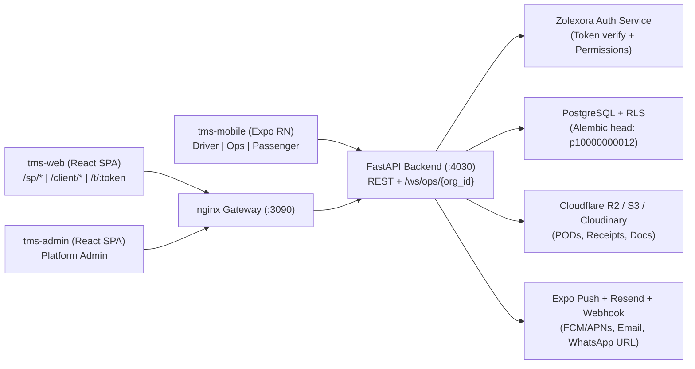
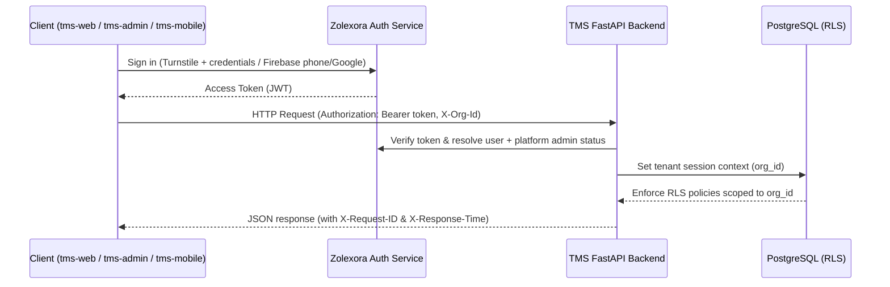
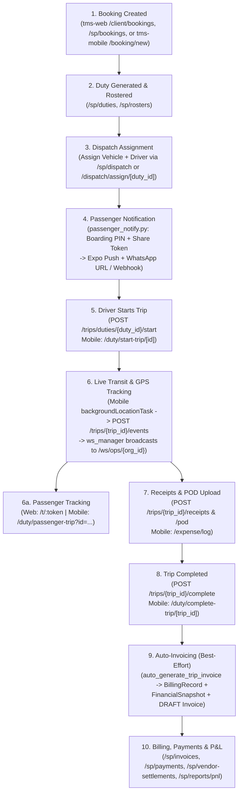

# Zolexora TMS — Complete Architecture & End-to-End System Flow

> **Scope:** `apps/platform-core/zolexora-tms` (Backend API, Web Portals, Admin Portal, Mobile App, Gateway, and Multi-Tenant Isolation)

---

## 1. High-Level Topology & Runtime Stack

Zolexora TMS runs as 4 Docker services orchestrated by [compose.yaml](../../compose.yaml) (with all secrets injected via Infisical `/Zolexora_TMS`), plus an Expo React Native mobile app (`tms-mobile`):

| Component | Path | Tech Stack | Port / Endpoint | Role |
|---|---|---|---|---|
| **Gateway (`nginx`)** | `Dockerfile.nginx`, `nginx-conf.d/` | Nginx | Host `${TMS_PORT:-3090}` → `80` | Single entrypoint routing traffic to web, admin, and backend API/WebSockets |
| **Web Portal (`tms-web`)** | `apps/tms-web` | Vite + React + React Query + React Router | Internal `80` | Public marketing site, Service Provider workspace (`/sp/*`), Client Portal (`/client/*`), Public tracking (`/t/:token`) |
| **Admin Portal (`tms-admin`)** | `apps/tms-admin` | Vite + React + React Query | Internal `80` | Platform-admin tenant & member management (`/`) |
| **Mobile App (`tms-mobile`)** | `apps/tms-mobile` | Expo SDK 54 / React Native 0.81.5 / Expo Router | EAS (`com.zolexora.tms`) | Driver, Dispatcher, Operations & Passenger/Client mobile workflows |
| **Backend (`backend`)** | `services/backend` | FastAPI + SQLAlchemy (async) + Alembic + PostgreSQL RLS | Host `${TMS_BACKEND_PORT:-4031}` → `4030` | Multi-tenant REST API, WebSocket ops hub (`/ws/ops/{org_id}`), billing/invoicing engine, push & webhook dispatch |

---

## 2. Authentication, Multi-Tenancy & PostgreSQL RLS Flow

Every protected API request passes through Zolexora's central auth service (`AUTH_SERVICE_URL`) and enforces tenant isolation at both the application layer (`app/auth/dependencies.py`, `app/core/tenant.py`) and PostgreSQL Row-Level Security (RLS).

- **Auth modules:** `services/backend/app/auth/zolexora.py`, `dependencies.py`, `catalog.py` (registers TMS permission catalog on startup in `app/main.py` `lifespan`).
- **Two isolated organisation workspaces in `tms-web`:**
  - **Service Provider (`/sp/*`)** guarded by `ProtectedRoute` → `DashboardLayout`
  - **Client Portal (`/client/*`)** guarded by `ClientRoute` → `ClientDashboardLayout`
- **Admin Portal (`tms-admin`):** Uses product key `zolexora-tms-admin` and `useAdminAuth` for cross-tenant platform administration (`TenantsPage`, `MembersPage`).

---

## 3. Backend Domain Modules (`services/backend/app/modules/`)

All routers are mounted in `app/main.py`:

| Domain | Sub-modules | Responsibilities |
|---|---|---|
| **Identity** | `organisations`, `users`, `roles` | Org creation/settings, memberships, role templates (`seed_platform_templates.py`), invites |
| **CRM** | `clients`, `customers`, `vendors` | B2B client accounts, customer locations, external fleet vendors & agreements |
| **Fleet** | `vehicles`, `drivers` | Vehicle master, driver profiles, compliance status |
| **Operations** | `bookings`, `duties`, `dispatch`, `rosters`, `operating_units`, `trips` | Booking requests, bookings, duty scheduling, shift rosters, dispatch board + `/ws/ops/{org_id}`, trip execution, receipts, POD, live events, public share tracking |
| **Finance** | `billing`, `invoices`, `payments`, `payables`, `expenses`, `pl` | Rate cards (`RateCardVersion.rules`), `FinancialEngine` snapshots, `DRAFT` invoice auto-generation & PDFs, invoice adjustments, receivables, vendor payables/settlements, driver expenses, P&L |
| **Core** | `health`, `platform`, `compliance`, `customization`, `devices`, `audit`, `extensions/r1rcm` | Health checks (`/health`, `/api/health`), platform capabilities, compliance engine/badges, custom fields, push `DeviceToken` registration, audit logs |
| **Integrations** | `fastag` | FASTag toll integration & RLS-protected toll records |

*(Note: `invoices`, `adjustments`, `payments`, `payables`, `expenses`, and `pl` routers are mounted under `/api/v1` in `app/main.py`.)*

---

## 4. End-to-End Operational Lifecycle (Booking → Dispatch → Live Trip → Invoice)

This is the core operational flow connecting **Client**, **Dispatcher/Ops**, **Driver**, **Passenger**, and **Finance**:

### Key Real-Time & Automated Flows

1. **Driver Live-Location WebSocket (`Dispatch` + `Trips`):**
   - **Mobile (`tms-mobile`):** Active trip starts background location updates (`backgroundLocationTask.ts`), posting GPS coordinates to `POST /trips/{trip_id}/events`.
   - **Backend:** Persists the `TripEvent` and broadcasts the update via `ws_manager` (`app/core/websocket.py`) to authenticated listeners connected on `WS /ws/ops/{org_id}`.
   - **Dispatch Board (`tms-web` `/sp/dispatch`):** Receives live vehicle/trip updates over `/ws/ops/{org_id}` (with `auth_ok` handshake and `ping`/`pong` keepalive).

2. **Passenger PIN Dispatch & Tracking:**
   - **Backend (`app/core/passenger_notify.py` + `app/core/push.py`):** Resolves passenger `DeviceToken` records via phone number (`_resolve_passenger_push_tokens`), deduplicates sends, and dispatches `send_passenger_boarding_pin_push` (FCM/APNs via Expo Push) alongside WhatsApp share URL / webhook notification.
   - **Mobile (`tms-mobile`):** Tapping the push notification deep-links directly into `/duty/passenger-trip` (`src/lib/usePushNotifications.ts`), and client users tapping `PASSENGER` duties in `(tabs)/workspace.tsx` route to `/duty/passenger-trip?id=...` showing live trip progress, `share_token`, timestamps, and boarding PIN.
   - **Web (`tms-web`):** Public tracking page at `/t/:token` (`PublicTrackingPage`).

3. **Auto-Invoicing on Trip Completion:**
   - When `POST /trips/{trip_id}/complete` runs (`app/modules/operations/trips/service.py` → `complete_trip`), it invokes `auto_generate_trip_invoice` (`app/modules/finance/invoices/routes.py`) in a best-effort block (never blocking trip completion if rate card setup is incomplete).
   - `FinancialEngine.calculate_snapshot` computes the `FinancialSnapshot` (converting `Decimal` inputs to `str` for JSONB compatibility in `app/modules/finance/billing/engine.py`), creates a `BillingRecord`, and uses `build_invoice_from_records` to generate a `DRAFT` invoice linked to `Booking.customer_id`.

---

## 5. Frontend & Mobile Route Map

### `tms-web` (`apps/tms-web/src/App.tsx`)
- **Public:** `/`, `/our-services`, `/solutions`, `/pricing`, `/about`, `/contact`, `/authentication`, `/invite`, `/invites/accept`, `/t/:token`
- **Service Provider (`/sp/*`):**
  - Operations: `/sp/dashboard`, `/sp/bookings`, `/sp/duties`, `/sp/dispatch`, `/sp/rosters`, `/sp/settings/operating-units`
  - Compliance & Master Data: `/sp/compliance`, `/sp/compliance/vehicles`, `/sp/compliance/drivers`, `/sp/compliance/customers`, `/sp/compliance/vendors`
  - Finance: `/sp/rate-cards/customers`, `/sp/rate-cards/vendors`, `/sp/billing`, `/sp/invoices`, `/sp/payments`, `/sp/payables`, `/sp/vendor-settlements`, `/sp/vendor-payments`, `/sp/receivables`, `/sp/financial-periods`, `/sp/expenses`
  - Reports & Settings: `/sp/reports/pnl`, `/sp/reports/sla-safety`, `/sp/settings`, `/sp/settings/roles`, `/sp/settings/members`, `/sp/profile`
- **Client Portal (`/client/*`):** `/client/dashboard`, `/client/bookings`, `/client/duties`, `/client/invoices`, `/client/payments`, `/client/settings`, `/client/profile`

### `tms-mobile` (`apps/tms-mobile/app/`)
- **Auth:** `/(auth)/login`
- **Tabs:** `/(tabs)/index`, `/(tabs)/duties`, `/(tabs)/workspace`, `/(tabs)/profile`
- **Workflows:** `/booking/new`, `/dispatch/assign/[duty_id]`, `/duty/[id]`, `/duty/start-trip/[id]`, `/duty/complete-trip/[trip_id]`, `/duty/passenger-trip`, `/expense/log`, `/vehicle/[id]`

---

## 6. Database & CI/CD Summary

- **Migrations (`services/backend/alembic/versions/`):** Managed strictly via Alembic (`alembic upgrade head`), current head: `p10000000012` (`p10000000012_rls_shift_rosters_and_fastag.py`).
- **Docker Images (CI-only via GHCR):** Built by `.github/workflows/zolexora-tms-docker.yml` (`reusable-docker-ghcr.yml`), pulled and run locally via `apps/platform-core/zolexora-tms/scripts/docker-start.sh`.
- **Mobile Builds (EAS):** Managed by `.github/workflows/zolexora-tms-eas.yml` (Node 22, Infisical `/Zolexora_TMS` secrets including `TMS_EXPO_TOKEN`, `lfs: true` for PNG assets).
