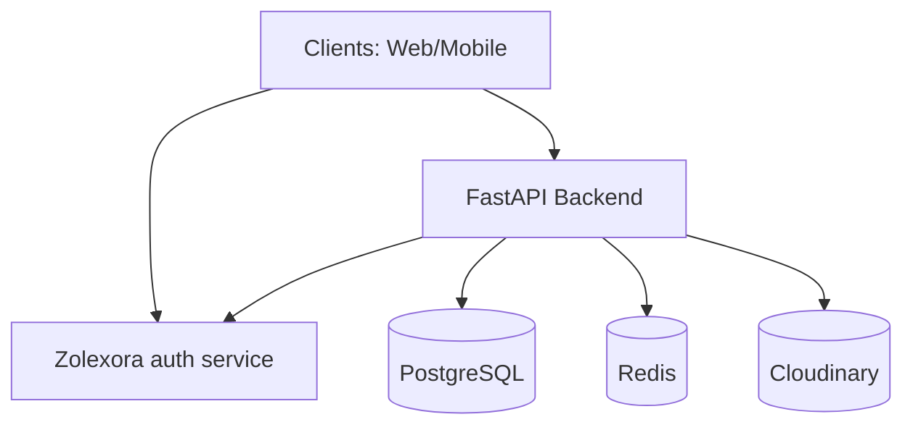
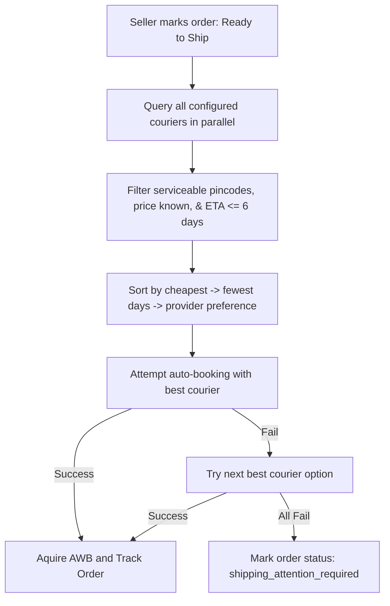

# Zolexora — Complete Super App Platform

> India's cleanest marketplace.

Reels and earnings moved out of the shop: reels to PostCread (`apps/standalone-apps/postcread/`) and earnings to the Zolexora auth service (wallet).

Zolexora is a transitional multi-app marketplace monorepo. Builds and tests are deterministic, but database isolation, payment routing, secure sessions, Oracle infrastructure, and production readiness are not complete.

---

## 📱 Platform Overview

Zolexora comprises six main applications and services that work together seamlessly:

| App / Service | Production URL | Local URL | Port / Metro | Technology | Purpose |
| :--- | :--- | :--- | :--- | :--- | :--- |
| **Zolexora Buyer Web** | `shop.zolexora.com` | `http://localhost:3000` | Port `3000` | Next.js 15 App Router | Zolexora customer storefront |
| **Mahila Buyer Web** | `mahilamadel.store` | legacy local client | — | React 18 | Transitional Mahila customer storefront |
| **Seller Web** | `seller.zolexora.com` | `http://localhost:3001` | Port `3001` | Next.js 15 App Router | Product uploads, order fulfilment |
| **Admin Web** | `admin.marketplace.zolexora.com` | `http://localhost:3002` | Port `3002` | Next.js 15 App Router | Shared marketplace operations |
| **Zolexora Buyer Mobile** | — | `http://localhost:8081` | Metro `8081` | Expo React Native | Zolexora customer binary |
| **Mahila Buyer Mobile** | — | `http://localhost:8083` | Metro `8083` | Expo React Native | Mahila customer shell |
| **Seller Mobile**| — | `http://localhost:8082` | Metro `8082` | Expo React Native | Mobile seller dashboard, product uploads |
| **Backend API** | `api.marketplace.zolexora.com` | `http://127.0.0.1:4100`| Port `4100` | FastAPI (Python 3.12) | Core business logic, auth, payments, shipping engine |

The API URL each app calls comes from Infisical (`NEXT_PUBLIC_API_URL`, `EXPO_PUBLIC_API_URL`, `CORS_ORIGINS`). The backend still recognises its own host from a hard-coded list that names `api.zolexora.com` (`services/marketplace-api/storefronts/registry.py`, `services/marketplace-api/database/repositories/storefronts.py`, and the `ck_storefront_domain_reject_surface_domains` constraint from migration 0003). It rejects storefront requests to any other host, so add `api.marketplace.zolexora.com` there before pointing Infisical at it.

## Storefront request context

FastAPI resolves `zolexora-shop` and `mahila-madel` from exact registered customer hosts, exact approved browser Origins on the shared API, or the public `X-Storefront-Key` buyer-mobile hint. Conflicts and unknown required context fail closed; seller/admin surfaces have no fixed customer storefront. This request context is not authentication, persisted-resource authorization, database isolation, or payment routing.

## Independent ERP boundary

Zolexora ERP is a separate commercial product/company and Marketplace is one customer. The proposed generic v1 contract is under `contracts/zolexora-erp/v1/`; no live ERP communication exists. Systems do not share databases, authentication, secrets, deployments, or releases, and checkout never waits synchronously for ERP.

## 🗄️ Data & Media Storage



* **PostgreSQL** is the only data store: users, catalog and stock, carts and quotes, orders and payments, shipments and pickup addresses, and wishlists. The schema is the Alembic chain in `services/marketplace-api/migrations/postgresql_versions/` (MongoDB was retired in migration 0024; old MongoDB data was not imported).
* **Zolexora auth service** signs everyone in; the API checks its tokens. There are no local passwords or roles.
* **Redis** holds caches and rate-limit counters only.
* **Cloudinary** holds media: `zolexora/products/`, `zolexora/avatars/`.

---

## ⚙️ Core Engines & Mechanisms

### 🚚 1. Parallel Shipping Orchestration
Zolexora integrates with 7 Indian shipping providers: **Delhivery**, **NimbusPost**, **Shiprocket**, **DTDC**, **Blue Dart**, **India Post**, and **Pickrr**. 

When a seller marks an order as **Ready to Ship** (via `services/marketplace-api/routers/shipping.py` and the shipping module), the auto-selection engine acts as follows:



1. **Service Verification**: Queries API endpoints of all configured couriers in parallel.
2. **Filtering**: Excludes providers that are unserviceable for the target pincode, take >6 days, or return errors.
3. **Sorting Priorities**:
   * **Priority 1**: Cheapest Rate.
   * **Priority 2**: Shortest Delivery Window.
   * **Priority 3**: Preference hierarchy (Delhivery first).
4. **Fallback loop**: If the chosen courier booking fails, the system automatically tries the next best provider.
5. **Oversight**: If all bookings fail, the status is flagged as `shipping_attention_required` and appears in the Admin Shipping Panel.
6. **Webhooks & Sync**: Providers send real-time webhooks to synchronize delivery tracking.

---

## 🛠️ Prerequisites & Installation

### Developer Tooling
Make sure you have the following installed on your machine:
* **Node.js** (Version ≥ 20) — [Install Node](https://nodejs.org)
* **pnpm** (Version ≥ 9) — Install via `npm i -g pnpm`
* **Python** (Version ≥ 3.12) — [Install Python](https://python.org)
* **Git** — [Install Git](https://git-scm.com)
* **Expo CLI** (For Mobile Testing) — Install via `npm install -g expo-cli eas-cli`

### Account setups (Free Tiers)
1. **Cloudinary**: Create a free account and copy your Cloud Name, API Key, and API Secret.
2. **Google Cloud Console**: Set up an OAuth 2.0 Web Application client. Add origins:
   * `http://localhost:3000`, `http://localhost:3001`, `http://localhost:3002`
   * `http://127.0.0.1:3000`, `http://127.0.0.1:3001`, `http://127.0.0.1:3002`
3. **Razorpay**: Register an account and generate a set of API test keys.
4. **Resend**: Open an account and create an API Key. Use default sandbox emails or verify your custom domain.

---

## ⚙️ Environment Variables Setup

Zolexora uses a multi-layered environment setup across its backend, web frontends, and mobile apps.

### 1. Quick Local Setup
Secrets come only from Infisical (`/Zolexora_Marketplace`); there are no `.env` files. Log in with `infisical login` and run commands through `bash scripts/setup/with-infisical.sh apps/standalone-apps/marketplace <command>`. Required keys per app: [docs/secrets.md](../../../docs/secrets.md).

### 2. Backend & Core Configuration
Configure these key subsystems in Infisical:

* **Startup validation (required)**: `APP_ENV`, `AUTH_SERVICE_URL`, `DATABASE_URL` (in Docker: `POSTGRES_PASSWORD`), `REDIS_URL`, `CORS_ORIGINS`. The API refuses to start without them.
* **Shipping Webhooks Verification**:
  * `SHIPPING_WEBHOOK_SECRET`: HMAC SHA256 secret to verify status updates from couriers (e.g., Shiprocket, Delhivery). Paste this webhook secret in your courier developer dashboard.
* **Cart Limits**:
  * `MAX_CART_QUANTITY`: Maximum quantity allowed per item type in cart (default: `100`).

To generate a secure 64-character JWT secret key if needed, execute:
```bash
python -c "import secrets; print(secrets.token_hex(64))"
```

### 3. Frontend & Mobile Client API Configuration
Web and mobile clients must configure the API endpoints:

* **Web Frontends (`apps/web/*`, `apps/admin`)**:
  * `NEXT_PUBLIC_API_URL`: The production API URL. During development, it falls back to `http://127.0.0.1:4100/api`.
  * `NEXT_PUBLIC_GOOGLE_CLIENT_ID`: OAuth Client ID.
  * `NEXT_PUBLIC_RAZORPAY_KEY` (Web Buyer only): Razorpay payment gateway key.
* **Mobile Clients (`apps/mobile/*`)**:
  * `EXPO_PUBLIC_API_URL`: The production API URL. During development, it falls back to `http://localhost:4100/api`.
  * `EXPO_PUBLIC_GOOGLE_CLIENT_ID`: OAuth Client ID.

---

## 🚀 Running the Project

### 1. Root & Workspace Setup
Install monorepo dependencies and backend packages:
```bash
# From the root directory
pnpm install

# Setup backend python packages

python -m venv .venv
source .venv/bin/activate        # On Windows: .venv\Scripts\activate
pip install -r services/marketplace-api/requirements.txt
```

### 2. Database
Apply the PostgreSQL migrations before starting the API (and after pulling new ones):
```bash
cd services/marketplace-api
bash ../../../../../scripts/setup/with-infisical.sh apps/standalone-apps/marketplace python -m alembic upgrade head
cd -
```

### 3. Spin Up Applications

#### Option A: Single Monorepo Terminal (Quickest for Web)
Runs all Next.js applications concurrently:
```bash
pnpm dev
```

#### Option B: Dedicated Terminals (Recommended for debugging)
Open 4 terminal windows:

* **Terminal 1: FastAPI API Backend**
  ```bash
  cd services/marketplace-api
  source ../../../.venv/bin/activate
  bash ../../../../../scripts/setup/with-infisical.sh apps/standalone-apps/marketplace uvicorn main:app --reload --port 4100
  ```
  API Docs (Swagger UI) will load at: `http://127.0.0.1:4100/docs`

* **Terminal 2: Zolexora Shop storefront**
  ```bash
  pnpm --filter @zolexora/shop-web dev
  ```
  Runs at: `http://localhost:3103`

* **Terminal 3: Seller Dashboard Client**
  ```bash
  pnpm --filter @zolexora/shop-seller-web dev
  ```
  Runs at: `http://localhost:3102`

* **Terminal 4: Admin Panel Client**
  ```bash
  pnpm --filter @zolexora/shop-admin dev
  ```
  Runs at: `http://localhost:3101`

#### Option C: Docker Local Stack (Complete Stack with Compose)
Run the entire platform (including database, backend, and all web frontends) inside Docker:
```bash
pnpm docker:shop:start   # pulls ghcr.io/zolexora/zolexora-shop-* images if missing; secrets via Infisical
```
*Gateway on `http://localhost:3079`; services are defined in [compose.yaml](compose.yaml).*

---

## 📱 Mobile App Running & Compiling

### 1. Developer Execution (Expo Go)
Open your terminal inside either buyer or seller mobile workspaces:
```bash
# Buyer Expo App
cd apps/mobile/shop
npx expo start

# Seller Expo App
cd apps/mobile/seller
npx expo start
```
* **Controls**: Press `a` to load on your Android Emulator, `i` for iOS Simulator, or scan the QR Code on your physical phone with the **Expo Go** application.

### 2. Google Sign-In setup on Mobile
Modify the client configuration inside `apps/mobile/shop/app/auth/index.tsx`:
```typescript
const [, , googlePromptAsync] = Google.useAuthRequest({
  androidClientId: "YOUR_ANDROID_CLIENT_ID",   // from Google Cloud Console
  iosClientId:     "YOUR_IOS_CLIENT_ID",        // from Google Cloud Console
  webClientId:     "YOUR_WEB_CLIENT_ID",        // same as GOOGLE_CLIENT_ID
});
```

---

## 🔐 Default Login Credentials & Seed Account

Administrators are the auth service's platform admins (Track 3); the marketplace keeps no admin accounts of its own.

---

## 📁 Monorepo Workspace Structure

```
zolexora/
├── services/marketplace-api/       ← FastAPI Python service
│   ├── main.py                     ← App Entry Point
│   ├── core/                       ← Configuration, DB connections, Auth schemas
│   │   ├── config.py               ← Global environment configuration
│   │   ├── supabase_client.py      ← Relational DB connector
│   │   └── cloudinary_client.py    ← Media CDN uploader
│   ├── models/                     ← Pydantic documents and collections types
│   ├── routers/                    ← HTTP API endpoints (Auth, Products, Payments)
│   ├── migrations/             ← PostgreSQL schema (Alembic, forward-only)
│   └── shipping/                   ← Courier selection logic
│       ├── base.py                 ← Shipping abstract structures
│       ├── rules.py                ← Auto-filtering ranking logic
│       └── service.py              ← Multi-carrier fallback booking engine
│
├── apps/                           ← Monorepo Frontends
│   ├── web-buyer/                  ← Next.js Client App (zolexora.com)
│   ├── web-seller/                 ← Next.js Vendor App (seller.zolexora.com)
│   ├── web-admin/                  ← Next.js Mod App (admin.zolexora.com)
│   ├── storefronts/                ← Customer web/mobile applications
│   └── portals/                    ← Shared seller/admin applications
│
└── packages/                       ← Shared Dev Modules
    ├── shared-api/                 ← Universal network API client schemas
    └── shared-config/              ← Shared configuration tokens (TS & Tailwind)
```

---

## 🔍 Verification & Health Checking

To verify that the backend is configured correctly and external integrations are fully operational, execute the health check query:
```bash
curl http://127.0.0.1:4100/api/health
```

Expected output:
```json
{
  "status": "ok",
  "version": "2.0.0",
  "cloudinary": true,
  "supabase": true,
  "razorpay": true,
  "upi": true,
  "google_auth": true,
  "email": true
}
```
> [!NOTE]
> If any service reports `false`, the corresponding development configuration may be missing or incorrect in Infisical (`/Zolexora_Marketplace`).

---

## 📡 API Reference Endpoint Map

### Authentication
* `POST /auth/register` — Initial register (Triggers verification email)
* `POST /auth/resend-otp` — Resends registration OTP code
* `POST /auth/verify-register` — Validates email OTP → Returns JWT
* `POST /auth/login` — Classic email password credentials verification → Returns JWT
* `GET /auth/me` — Fetches current caller profile

### Product Catalogs
* `GET /products` — Query products with sorting, filtering, and text search
* `GET /products/:id` — Retrives a single product detail
* `POST /products` — Creates product (Seller Role required)
* `PUT /products/:id` — Edits product attributes
* `DELETE /products/:id` — Deletes product index
* `POST /products/:id/upload-image` — Uploads image to Cloudinary

### Checkout & Cart
* `GET /cart` — Retrives current items in cart
* `POST /cart/items` — Adds product to cart
* `PUT /cart/items/:id` — Updates quantity of target item
* `DELETE /cart/items/:id` — Removes item from cart
* `POST /cart/checkout` — Generates Razorpay transaction object
* `POST /cart/checkout/verify-payment` — Validates Razorpay API signatures

### Shipping & Couriers
* `GET/POST /shipping/pickup-locations` — Coordinates pickup warehouses
* `POST /shipping/orders/:id/ready-to-ship` — Launches the courier auto-booking engine
* `GET /shipping/orders/:id/options` — Lists prices and ETAs of all evaluated providers
* `POST /shipping/orders/:id/manual-book` — Bypasses ranking and books a specific courier
* `GET /shipping/track/:awb` — Checks tracking status by Air Waybill number
* `POST /shipping/shipments/:id/retry-booking` — Restarts booking attempts for failed orders

### Admin Management
* `GET /admin/stats` — Core platform statistics and volumes
* `GET /admin/analytics` — Platform user growth curves
* `GET /admin/users` — Queries complete user registry
* `GET /admin/shipping/shipments` — Shipping registry
* `GET /admin/shipping/shipments/attention-required` — Shows only failed bookings for manual intervention

---

## 🚀 Production Deployment Playbook

### 1. Backend → Northflank
Deploy the backend as a combined service from the GitLab repository.

* Service: `zolexora-api`
* Branch: `zolexora-deploy`
* Root/workdir: `backend`
* Dockerfile: `services/marketplace-api/Dockerfile`
* Port: `4100`
* Health check: `/api/health`

### 2. Web Frontends → Vercel
Deploy your apps independently:
```bash
# Install Vercel globally
npm i -g vercel

# Deploy Buyer Frontend
cd apps/web/shop
vercel --prod

# Deploy Seller Frontend
cd apps/web/seller
vercel --prod

# Deploy Admin Frontend
cd apps/admin
vercel --prod
```
**Vercel Dashboard Routing Settings**:
* **Zolexora storefront**: `apps/web/shop`, target domain `shop.zolexora.com`
* **Seller portal**: `apps/web/seller`, target domain `seller.zolexora.com`
* **Marketplace admin**: `apps/admin`, target domain `admin.marketplace.zolexora.com`

Projects created before the apps layout change need their Root Directory updated: see [docs/runbooks/apps-layout-deployment.md](docs/runbooks/apps-layout-deployment.md).

> [!IMPORTANT]
> Remember to add `NEXT_PUBLIC_API_URL=https://api--zolexora-api--4m8d68ky29h8.code.run/api` as an environment variable in all your Vercel projects.

### 3. Mobile Compiles → Expo Application Services (EAS)
Generate binaries for iOS and Android:
```bash
npm install -g eas-cli
eas login

# Build Buyer Mobile Client
cd apps/mobile/shop
eas build --platform all --profile preview

# Build Seller Creator Client
cd apps/mobile/seller
eas build --platform all --profile preview
```

### 4. Direct Linux VPS Hosting (Nginx & Docker)
To deploy the backend on a private VPS (like AWS EC2, DigitalOcean, or Hetzner):

* **Scaling via Docker Compose**:
  Configure nginx to reverse proxy and scale backend containers:
  ```bash
  # Boot 4 parallel FastAPI worker instances (images from GHCR, secrets from Infisical)
  bash scripts/setup/with-infisical.sh apps/standalone-apps/marketplace \
    docker compose -f apps/standalone-apps/marketplace/compose.yaml up -d --scale backend=4
  ```

* **Manual Setup with Nginx Load Balancing**:
  Copy the nginx config and create worker processes:
  ```bash
  sudo cp apps/standalone-apps/marketplace/nginx.conf /etc/nginx/sites-available/zolexora
  sudo ln -s /etc/nginx/sites-available/zolexora /etc/nginx/sites-enabled/
  sudo nginx -t && sudo systemctl reload nginx
  
  # Start 4 FastAPI workers on separate ports
  for PORT in 8001 8002 8003 8004; do
    uvicorn main:app --host 127.0.0.1 --port $PORT --workers 1 --proxy-headers &
  done
  ```

---

## 🛠️ Troubleshooting & Fixes

| Symptom | Cause | Solution |
| :--- | :--- | :--- |
| **`CORS Blocked`** | Calling address not in allowed list | Add your frontend domain or local IP (e.g. `http://localhost:3001`) to `CORS_ORIGINS` in Infisical |
| **`Database is temporarily unavailable`** | PostgreSQL unreachable or `DATABASE_URL` wrong | Check the `DATABASE_URL` / `POSTGRES_PASSWORD` key in Infisical and that the database is running |
| **`Google Login Fails`** | Mismatched client ID strings | Confirm the Google client ID keys in Infisical match the frontend configuration |
| **`Uploaded images not visible`** | Missing or incorrect CDN credentials | Validate `CLOUDINARY_CLOUD_NAME`, `CLOUDINARY_API_KEY`, and `CLOUDINARY_API_SECRET` in Infisical |
| **`Verification Emails not sending`** | Resend API auth failure | Ensure your Resend domain is verified at [resend.com/domains](https://resend.com/domains) and matches your `SENDER_EMAIL` |
| **`Razorpay payment modal fails`** | Invalid merchant key loading | Ensure `NEXT_PUBLIC_RAZORPAY_KEY` is set in Infisical |
| **`Admin portal displays blank screen`** | Signed-in account is not a platform admin | Sign in with an auth-service platform admin (Track 3) account |
| **`Port 4100 Address Already in Use`** | Zombie python process running | Free the port by running: `lsof -ti:4100 \| xargs kill -9` |

---

## 📞 Support & Resources
* **Backend Health Check Route**: `https://api--zolexora-api--4m8d68ky29h8.code.run/api/health`
* **API Documentation Endpoint**: `https://api.marketplace.zolexora.com/docs`

