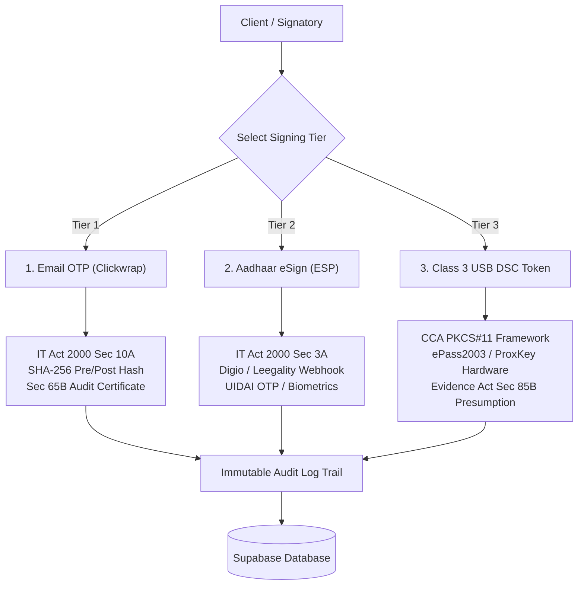

# Zolexora App Suite — Documentation & Architecture Guide

## Overview

**Zolexora App Suite** is the client-facing intake, legal contract management, and project execution portal for the dedicated Zolexora on-demand application engineering team.

Clients submit software specifications, review structured milestone proposals, and digitally execute legally binding agreements (MSAs, SOWs, NDAs) compliant with Indian law.

> **Key Architectural Boundary:** Applications commissioned through Zolexora App Suite are deployed directly to the client's designated cloud infrastructure or external Git repositories. They are **never stored, maintained, or version-controlled inside the Zolexora platform monorepo**.

---

## Repository & Monorepo Structure

```
products/zolexora-app-suite/
├── package.json                   # Product package metadata & scripts
├── README.md                      # Quickstart guide
├── schema.sql                     # Supabase/PostgreSQL schema with RLS & audit trails
├── docs/                          # Product-specific guides and runbooks
└── apps/
    └── web/                       # Next.js 15 Fullstack App Router application
        ├── app/
        │   ├── (marketing)/       # Public landing page (Hero, Services, How It Works)
        │   │   ├── page.tsx
        │   │   └── layout.tsx
        │   ├── (dashboard)/       # Workspace area (no auth friction)
        │   │   ├── dashboard/
        │   │   │   ├── page.tsx           # Workspace Overview & Metrics
        │   │   │   ├── new-request/       # Requirement intake form
        │   │   │   ├── requests/          # Request tracking & milestone timeline
        │   │   │   └── contracts/         # Legal contract review & digital signing
        │   │   └── layout.tsx             # Shared sidebar layout
        │   └── api/
        │       ├── requests/route.ts      # REST API for application requests
        │       └── contracts/
        │           ├── [id]/document/     # Printable legal HTML/PDF route with SHA-256
        │           └── esign/webhook/     # Digio / Leegality Aadhaar eSign webhook
        ├── components/
        │   ├── ui/                # UI primitives (Button, LinkButton, Card, Badge, etc.)
        │   ├── landing/           # Navbar, Footer, and Landing sections
        │   └── dashboard/         # Sidebar, DigitalSigningModal
        ├── lib/
        │   ├── actions/           # Next.js Server Actions (contracts.ts, requests.ts)
        │   ├── audit-logger.ts    # Section 65B Indian Evidence Act audit trail logger
        │   ├── contract-generator.ts # Legal HTML contract template generator
        │   ├── dsc-verifier.ts    # Class 3 USB Token (CCA PKCS#11 / X.509) verifier
        │   ├── esign-gateway.ts   # Aadhaar eSign (Digio / Leegality) session & webhook parser
        │   ├── legal-clauses.ts   # Vetted Indian legal clause templates (MSA, SOW, NDA)
        │   ├── supabase/          # Supabase SSR client & server helpers
        │   └── types.ts           # Centralized TypeScript interfaces
        ├── middleware.ts          # Edge routing middleware
        └── next.config.ts         # Server actions & origin configuration
```

---

## Tech Stack

| Layer | Technology | Rationale |
| :--- | :--- | :--- |
| **Framework** | Next.js 15.5+ (App Router) | High-performance React 19 server components and server actions. |
| **Styling** | Tailwind CSS v4 (`@tailwindcss/postcss`) | Aligned with platform design tokens and dark aesthetic. |
| **Icons** | Lucide React | Consistent UI icon set across the monorepo. |
| **Database** | Managed PostgreSQL 16 (via Supabase) | Relational integrity, JSONB metadata, and Row Level Security (RLS). |
| **Digital Signatures** | Web Crypto + CCA PKCS#11 + Digio/Leegality | Three-tier legal signing compliant with Indian IT Act 2000. |

---

## Indian Legal & Digital Contracting Framework

Zolexora App Suite incorporates a 3-tier digital execution model tailored to Indian commercial and cyber law:



### 1. Statutory Compliance Matrix

- **Information Technology Act, 2000 (Section 10A):** Validates contracts formed through electronic records and digital acceptance.
- **Indian Evidence Act, 1872 (Section 65B):** Mandates an unbroken cryptographic audit trail (IP address, user-agent, UTC timestamp, and document SHA-256 hash) for admissibility in Indian courts.
- **Indian Evidence Act, 1872 (Section 85B):** Grants legal presumption of authenticity to documents executed via certified Digital Signature Certificates (Class 3 USB tokens).
- **Indian Stamp Act, 1899:** Contracts reference state stamp duty compliance (e.g., Maharashtra, Karnataka, Delhi e-Stamping).
- **Copyright Act, 1957 (Section 19):** All customized code remains the property of Zolexora until 100% full consideration is received (**Condition Precedent**).

---

## Core Contract Templates & Clauses

Pre-configured in [`lib/legal-clauses.ts`](file:///workspaces/Zolexora_Platform/products/zolexora-app-suite/apps/web/lib/legal-clauses.ts):

1. **Master Services Agreement (MSA):**
   - **IP Transfer Condition Precedent:** Intellectual property transfers only upon full payment settlement.
   - **Repository Isolation:** Clear boundary confirming deliverables live on client servers, not in the Zolexora platform repo.
   - **Warranty Window:** 30-day bug-fix guarantee, transitioning to an AMC.
   - **Arbitration & Seat:** Arbitration and Conciliation Act, 1996 in Maharashtra, India.
2. **Statement of Work (SOW):**
   - Milestone schedule, GST invoicing (18%), and change order management.
3. **Non-Disclosure Agreement (NDA):**
   - Mutual confidentiality protecting proprietary ideas and internal boilerplates.

---

## Development & Operations Runbook

### Prerequisites
- Node.js >= 20.x (Recommended: Node.js 22+)
- pnpm >= 9.x
- Active workspace virtual environment or shell

### Installation & Local Setup

```bash
# 1. Navigate to the App Suite web application
cd /workspaces/Zolexora_Platform/products/zolexora-app-suite/apps/web

# 2. Configure environment variables
cp .env.example .env.local

# 3. Install workspace dependencies
pnpm install

# 4. Start the development server (runs on port 3070)
pnpm dev
```

### Type Checking & Build Verification

```bash
# Run strict TypeScript compiler verification
pnpm --filter @zas/web type-check

# Production build
pnpm --filter @zas/web build
```

---

## API Endpoints

| Endpoint | Method | Description |
| :--- | :--- | :--- |
| `/api/requests` | `GET` | Retrieve submitted application requests. |
| `/api/requests` | `POST` | Create a new application development request programmatically. |
| `/api/contracts/[id]/document` | `GET` | Render the printable legal agreement with SHA-256 headers and audit logging. |
| `/api/contracts/esign/webhook` | `POST` | Public webhook callback for Digio / Leegality completion events. |

---

## Database Migrations

To apply schema updates and Row Level Security policies, execute the SQL definitions in:
👉 [`products/zolexora-app-suite/schema.sql`](file:///workspaces/Zolexora_Platform/products/zolexora-app-suite/schema.sql) in your Supabase SQL editor or migration pipeline.
