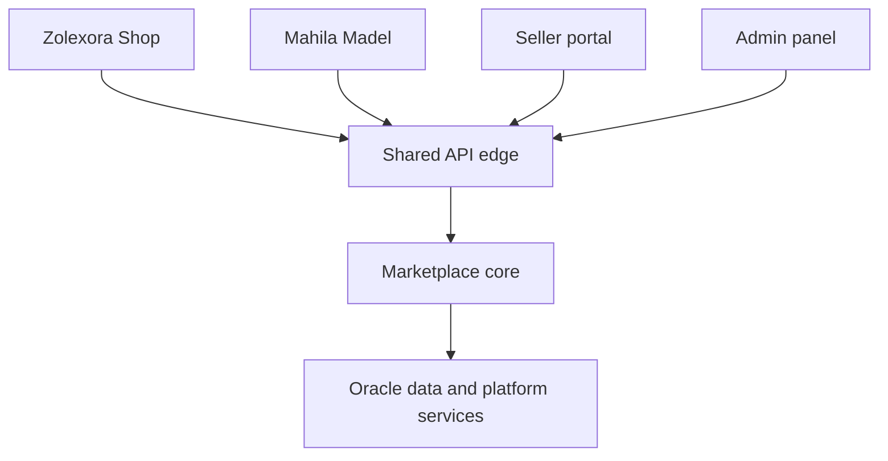

# Architecture

## Purpose

This document separates the repository's current architecture from the approved multi-storefront target. The target is a migration destination, not a statement of present capability.

## Current architecture

The repository currently contains two partially independent commerce systems.

### Zolexora platform

| Layer | Current implementation |
| --- | --- |
| Buyer web | Next.js app at `apps/storefronts/zolexora-shop/web` |
| Seller web | Next.js app at `apps/portals/seller/web` |
| Admin web | Next.js app at `apps/portals/marketplace-admin/web` |
| Zolexora buyer mobile | Expo app at `apps/storefronts/zolexora-shop/mobile` |
| Mahila buyer mobile | Expo shell at `apps/storefronts/mahila-madel/mobile` |
| Shared seller mobile | Expo app at `apps/portals/seller/mobile` |
| API | FastAPI at `services/marketplace-api/` |
| Document persistence | MongoDB for products, carts, orders, reels, rewards, and operational documents |
| Relational/auth persistence | Supabase PostgreSQL and Supabase Auth for users and related relational data |
| Cache | Redis |
| Media | Cloudinary |
| Payments | One global Razorpay configuration plus UPI settings |
| Shipping | Shared orchestration with provider adapters and signed shipping webhooks |

### Mahila Madel application

Mahila Madel is currently a standalone ShopKart-derived application:

- React 18 client in `apps/storefronts/mahila-madel/web`.
- Express/Mongoose server in `apps/storefronts/mahila-madel/legacy-server`.
- Its own users, products, carts, wishlists, orders, admin UI, and JWT authentication.
- Checkout values are accepted from the client and the payment flow is demonstration-level rather than a verified gateway integration.

This duplication is transitional. It is not the future service boundary.

Each customer storefront owns a separate web and mobile binary. Both mobile apps target the shared FastAPI API, while seller mobile is cross-store and has no fixed customer storefront.

### Implemented request-context foundation

`services/marketplace-api/storefronts/` now resolves a typed request context from an exact customer host, exact approved Origin on the shared API host, or validated buyer-mobile hint. Conflicting signals fail closed, forwarded-host headers are not trusted, and seller/admin hosts remain cross-store. `GET /api/storefront/context` exposes only safe public metadata.

This boundary is request-level only. Products, carts, orders, payments, analytics, and persistence queries remain unscoped; seller grants and payment-account routing are not implemented.

## Target system context

The API edge resolves a trusted storefront context before calling commerce modules. Seller and admin requests may operate across multiple storefronts, but only within explicit role and resource permissions.

## Target logical components

| Component | Responsibility |
| --- | --- |
| Storefront registry | Maps approved hosts to active storefront records and configuration |
| Identity and access | Users, sessions, roles, seller membership, admin permissions |
| Catalog | Master products, variants, attributes, categories, and media references |
| Listings | Store-specific publication state, price, merchandising, and visibility |
| Inventory | Shared stock ledger, reservations, adjustments, and availability |
| Cart | Storefront-bound customer intent; rejects cross-store mixing |
| Pricing | Server-side price, discount, tax, shipping, coin, and total calculation |
| Checkout | Validates cart, reserves inventory, creates immutable order snapshots |
| Payments | Routes to the storefront's provider account and owns payment lifecycle |
| Orders | Order state, item snapshots, fulfillment, cancellation, returns, and refunds |
| Shipping | Pickup locations, provider discovery, booking, tracking, and webhooks |
| Media | Provider-neutral uploads and OCI Object Storage references |
| Engagement | Reels, view rewards, coins, and eligible discount conversion |
| Administration | Cross-store governance, moderation, support, and audit operations |
| Analytics | Storefront-aware operational and business events |

## Request flow and storefront context

1. The load balancer preserves the original `Host` and forwarding metadata.
2. Trusted proxy middleware validates the forwarding chain.
3. The current static resolver maps exact signals to a stable storefront key; a future persisted registry will supply `storefront_id`.
4. Authentication resolves the user and session independently of storefront identity.
5. Authorization combines user role, seller membership, resource ownership, and storefront scope.
6. Application services require a typed storefront context for storefront-scoped operations.
7. Persistence queries include the required scope, and newly created records persist it.
8. Logs, traces, metrics, and domain events include `storefront_id` without exposing secrets or personal data.

Unknown or disabled customer hosts fail closed. The API never trusts an arbitrary browser header to choose a storefront or payment account.

## Core invariants

- A cart belongs to exactly one storefront.
- A checkout cannot combine listings from different storefronts.
- A listing belongs to exactly one storefront and references one master product or variant.
- An order stores immutable `storefront_id`, seller, item, price, tax, discount, currency, and payment-routing snapshots.
- Inventory mutations are transactional and idempotent.
- Financial amounts use integer minor units or fixed-precision decimals; never binary floating point in the target model.
- Every payment attempt references one order and one storefront-owned payment account.
- Webhook processing verifies signatures against the account selected by trusted persisted payment data.
- Seller and admin cross-store visibility is explicit and auditable.

## Target deployment shape

- OCI DNS/WAF/Load Balancer terminates public traffic and routes it to ARM64-compatible application workloads.
- Web frontends and the FastAPI backend are packaged as immutable images in OCIR.
- Oracle Autonomous Database is the canonical relational data store.
- OCI Cache provides ephemeral caching, rate-limit state, and coordination where justified.
- OCI Object Storage holds media and exports through a storage adapter.
- Secret Management supplies runtime credentials using workload identity where possible.
- OCI Logging, Monitoring, alarms, and audit services provide operational visibility.

See [oracle-infrastructure.md](oracle-infrastructure.md) for the full target topology.

## Migration boundaries

### Independent ERP integration boundary

Zolexora ERP is outside the Marketplace system/company boundary. It owns its repository, MariaDB/Frappe sites, identity, deployment, secrets, backups, releases, and administrators. Marketplace is one ERP customer. Only FastAPI may later communicate through the generic versioned contract; clients never call ERP. A future Oracle outbox keeps delivery asynchronous, with an ERP inbox and reconciliation preventing loss and duplicates. See [erp-integration.md](erp-integration.md) and [data-ownership.md](data-ownership.md).

The migration should use a modular monolith first. Clear module interfaces and provider adapters are required, but distributing modules into independent network services is not an initial goal.

1. Make the monorepo baseline deterministic.
2. Introduce trusted storefront context and target data ownership.
3. Move Mahila Madel onto the shared APIs while preserving its brand experience.
4. Introduce provider-neutral payment orchestration and separate merchant configuration.
5. Replace current persistence, media, cache, and secret integrations with OCI-backed adapters.
6. Deploy, validate, and cut over domains incrementally.

During migration, adapters may support current providers, but new business logic must depend on internal interfaces rather than provider SDKs directly.

## Known current gaps

- No canonical `storefront_id`, storefront registry, listing model, or immutable order-origin field.
- Phase 1.5 established the canonical capability-oriented tree; pnpm, CI, and Compose use those paths.
- Storage ownership is split between MongoDB and Supabase, with a second MongoDB model in Mahila Madel.
- One global Razorpay/UPI configuration is used and the client can currently request a payment method.
- Payment webhooks, refund orchestration, robust idempotency, and reconciliation are incomplete.
- Web clients currently use bearer-token patterns that must migrate to secure sessions.
- Oracle storefront/domain and integration-reliability schema metadata plus one forward Alembic migration now exist and resolve production storefront context through an injected repository. Real Oracle execution, commerce persistence, IaC, Object Storage, Vault integration, and verified ARM64 images do not yet exist.
