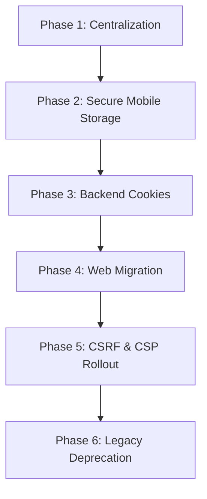

# Security Audit & Migration Proposal: Safer Auth Token Storage

This document provides a security audit of the current token storage architecture for **ZolexoraShop** across web applications, mobile applications, and shared API libraries. It outlines the risks associated with the current implementation and proposes a migration path toward a safer session-handling mechanism.

---

## 1. Current State of Token Storage

### Web applications (Zolexora storefront, seller portal, marketplace admin)
- **Storage Location**: `localStorage` (e.g., `localStorage.getItem("z_token")`, `localStorage.getItem("z_seller_token")`, `localStorage.getItem("z_admin_token")`).
- **Authorization Flow**: Axios/Fetch client interceptors extract the token from `localStorage` on each client request and attach it to the `Authorization: Bearer <token>` header.
- **State Management**: The token is also duplicated inside `zustand` persist stores under keys like `z_auth`, `z_seller_auth`, and `z_admin_auth`.

### Mobile applications (buyer and seller)
- **Storage Location**: `expo-secure-store` (e.g., `SecureStore.getItemAsync("z_token")`, `SecureStore.getItemAsync("z_seller_token")`).
- **Authorization Flow**: Custom API clients extract tokens from `SecureStore` asynchronously on request interception and send them via `Authorization: Bearer <token>`.

### Shared API Library (`@zolexora/shared-api`)
- **Storage Location**: `localStorage` with a fallback key constant `zolexora_token`.

---

## 2. Identified Security Risks

1. **XSS (Cross-Site Scripting) Attacks (Web)**
   - Because tokens are stored in `localStorage`, any script executing in the browser (e.g., via a compromised npm package, third-party script, or client-side injection vulnerability) can read `localStorage` directly.

2. **Malicious Browser Extensions (Web)**
   - Browser extensions can access the page DOM and storage mechanisms, presenting a vector for token extraction.

3. **Persistent Token Exposure (Web & Mobile)**
   - Storing credentials in unencrypted `localStorage` means they remain on disk even after the browser tab is closed. If a shared device is used, tokens may be exposed to subsequent users.

4. **Lack of Cryptographic Binding (Web)**
   - Bearer tokens are not bound to the client's session state. If stolen, they can be replayed from any client/origin unless constrained by IP/Geographical restriction policies on the backend.

---

## 3. Recommended Web Target Design: HttpOnly Cookie Sessions

To eliminate the risks of `localStorage` token storage, we recommend transitioning to **HttpOnly, Secure, and SameSite** cookie-based session handling.

```
┌───────────┐                Login (Credentials)                ┌──────────┐
│  Browser  │ ────────────────────────────────────────────────> │  Backend │
│           │ <──────────────────────────────────────────────── │   API    │
└───────────┘    Set-Cookie: session_id; HttpOnly; Secure;      └──────────┘
                         SameSite=Lax (No JS access!)
```

### Key Security Controls
1. **`HttpOnly` Flag**: Prevents client-side JavaScript from accessing the cookie containing the authentication token, neutralizing XSS-based token theft.
2. **`Secure` Flag**: Ensures the cookie is only transmitted over encrypted HTTPS connections, preventing man-in-the-middle sniffing.
3. **`SameSite=Lax` or `Strict`**: Protects against Cross-Site Request Forgery (CSRF) attacks by restricting cookie transmission on cross-site requests.
4. **CSRF Protection**: For state-changing requests (`POST`, `PUT`, `DELETE`), require a CSRF token (e.g., Double Submit Cookie pattern) to prevent cross-site request forgery.
5. **CORS Allowlist**: Configure strict `Access-Control-Allow-Origin` values that allow only trusted application domains and subdomains (e.g., `*.zolexora.com`), and enable `Access-Control-Allow-Credentials`.
6. **Backend Session Invalidation**: Ensure that logging out deletes the session record in the database/Redis and clears the client-side cookies.

---

## 4. Recommended Mobile Target Design: Secure OS Storage

Mobile applications are not subject to standard browser XSS or CSRF risks, but they must protect data from unauthorized physical access or backup leakage.

1. **Expo SecureStore (Currently Active)**: The mobile applications are already correctly using `expo-secure-store`. This wraps the native OS secure storage mechanisms:
   - **iOS**: Keychain services.
   - **Android**: Shared Preferences backed by KeyStore.
2. **Auto-clearing on Logout**: Ensure that `SecureStore.deleteItemAsync` is always called when the user logs out.
3. **Encrypted Storage Backups**: Configure Android/iOS backup manifests to exclude secure storage data from unencrypted cloud backups.

---

## 5. Proposed Migration Phases



### Phase 1: Centralization & Logging Redaction (Completed)
- Centralize `localStorage` string keys inside store files.
- Redact any auth token print statements from logs.

### Phase 2: Native Mobile Hardening (Completed)
- Enforce the use of `expo-secure-store` across all mobile channels.
- Implement secure cleanup routines on logout.

### Phase 3: Backend Cookie & CSRF Support
- Update backend auth routers to support parsing authorization from cookies in addition to `Authorization` headers.
- Implement cookie-setting middleware that writes `session` or JWT cookies using `HttpOnly; Secure; SameSite=Lax; Path=/`.
- Introduce a stateless CSRF token mechanism (e.g., using `X-CSRF-Token` headers verified against a cryptographically signed cookie).

### Phase 4: Web App Client Refactoring
- Refactor the Zolexora storefront, seller portal, and marketplace-admin HTTP clients to pass `credentials: "include"` (or `withCredentials: true`), allowing cookies to be automatically transmitted.
- Remove client-side token extraction and injection from local storage.

### Phase 5: Testing & Security Header (CSP) Hardening
- Roll out Content Security Policy (CSP) headers restricting script source domains.
- Validate cookie-based flows across subdomains (e.g., `seller.zolexora.com`, `admin.zolexora.com`) and local development environments.

### Phase 6: Legacy Header Deprecation
- Remove fallback bearer token validation headers from the backend API endpoints.

---

## 6. Compatibility & Implementation Risks

1. **Subdomain Cookie Sharing**:
   - The web apps might run on separate subdomains (e.g., `admin.zolexora.com`, `seller.zolexora.com`, `zolexora.com`).
   - The backend must configure cookie domains to `.zolexora.com` to ensure session cookies are sent across all apps, while restricting access appropriately.
2. **Local Development (HTTP vs HTTPS)**:
   - Modern browsers block `Secure` cookies over non-localhost HTTP connections. Local developer setups must run on `localhost` or use SSL certificates (e.g., via `mkcert`) to support testing secure cookies.
3. **Supabase Auth Client Integration**:
   - The backend relies on Supabase Auth. Supabase client libraries natively support setting and reading session cookies, but this requires configuring matching cookie domain parameters on the Supabase client options.
