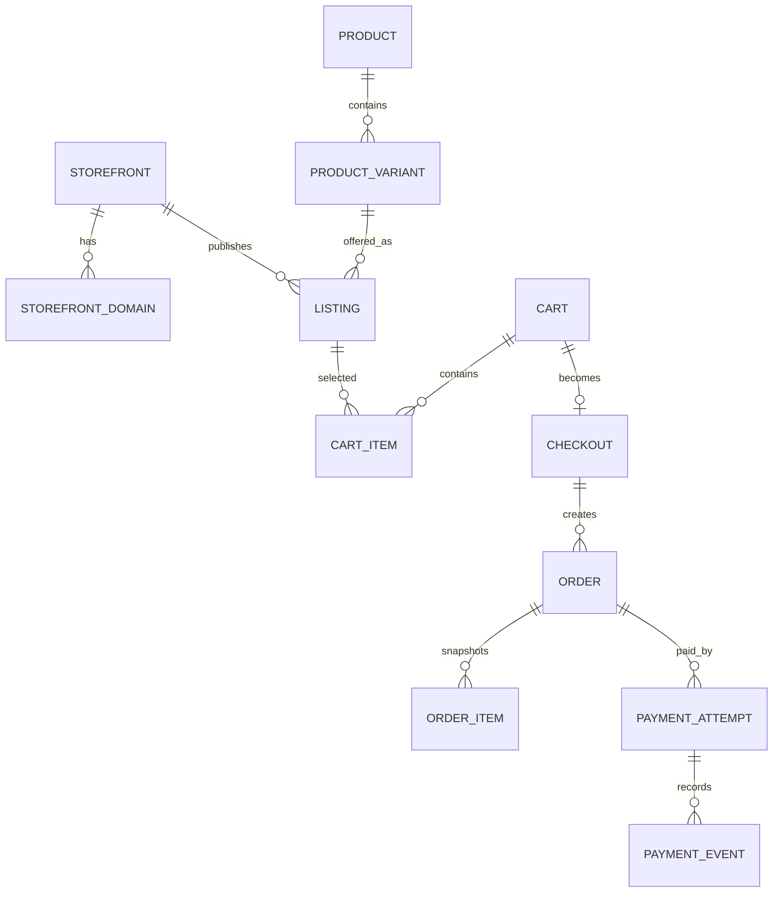

# Data model

## Scope

This is the target conceptual model for the shared Oracle-backed platform. It guides migrations and APIs; it does not describe tables that already exist. Current MongoDB, Supabase, and Mahila Mongoose structures require deliberate migration or retirement.

## Modeling rules

- Use generated, opaque primary keys. Public slugs and order numbers are separate unique fields.
- Store all timestamps in UTC and render them in the user's locale.
- Store money as integer minor units plus ISO currency, or as fixed-precision Oracle numbers with a single enforced convention.
- Never use binary floating point for persisted financial values.
- Use optimistic versioning or row locks for inventory and other contested updates.
- Use status constraints and controlled transitions rather than arbitrary strings.
- Prefer immutable ledgers and events for money, inventory, rewards, and audit history.
- Soft deletion is allowed only where history must be retained; active unique constraints must still be enforced.
- Storefront-scoped uniqueness includes `storefront_id`.
- Sensitive provider credentials are secret references, not database values.

## Core relationships

## Storefront and configuration

### `storefront`

| Field | Rule |
| --- | --- |
| `id` | Primary key; immutable |
| `key` | Stable unique machine key, e.g. `zolexora-shop` |
| `display_name` | Customer-facing brand name |
| `status` | `draft`, `active`, `ordering_paused`, or `disabled` |
| `default_currency` | Initially `INR` |
| `locale` | Initial locale policy for the storefront |
| `brand_config` | Versioned non-secret display configuration |
| timestamps | Created and updated UTC timestamps |

### `storefront_domain`

Maps normalized hosts to a storefront. A host is globally unique. Fields include `storefront_id`, `host`, `kind`, `is_primary`, `verified_at`, and `active`.

### `payment_account`

Identifies a provider account owned by one storefront. It stores provider type, environment, merchant reference, secret references, webhook endpoint key, status, capabilities, and configuration version. Secret values never live in this table.

## Identity and authorization

### `user_account`

Canonical identity with email/phone verification status, account state, and audit timestamps. Provider identities are modeled separately to avoid duplicating users.

### `auth_identity` and `session`

- `auth_identity`: provider, provider subject, user ID, verification metadata.
- `session`: opaque session ID hash, user ID, created/last-seen/expiry timestamps, revocation data, device metadata, and rotation family.

Refresh/session secrets are never stored in plaintext.

### Seller access

- `seller_organization`: legal/display identity and operational state.
- `seller_member`: user-to-organization membership and role.
- `seller_storefront_grant`: explicit permission to publish or operate on a storefront.
- `pickup_location`: seller-owned shipping origin with verification state.

### Administrative access

Use role and permission tables or an equivalent policy model. Record sensitive mutations in an append-only `audit_event` with actor, action, resource, storefront, correlation ID, and safe before/after metadata.

## Catalog, listings, and inventory

### `product`

Seller-owned master content: product type, title, description, brand, category, lifecycle state, and metadata.

### `product_variant`

Sellable identity: product ID, SKU, barcode if used, attributes, weight, dimensions, and lifecycle state. SKU uniqueness is defined within the appropriate seller or platform namespace.

### `listing`

Store-specific offer:

| Field | Rule |
| --- | --- |
| `storefront_id` | Required and immutable after publication |
| `variant_id` | Required reference to master variant |
| `seller_id` | Denormalized or constrained ownership reference for safe scoping |
| `slug` | Unique within storefront |
| `status` | Draft, scheduled, active, paused, rejected, archived |
| `price_minor` | Current server-authoritative selling price |
| `compare_at_minor` | Optional reference price; must not be below selling price |
| `currency` | Must match supported storefront currency |
| `content_overrides` | Optional store-specific title/copy/SEO fields |
| publish timestamps | Scheduling and audit data |

### Inventory

- `inventory_location`: physical or logical stock location.
- `inventory_balance`: current on-hand, reserved, and available quantity per variant/location.
- `inventory_ledger`: immutable adjustments with reason, actor, reference, and idempotency key.
- `inventory_reservation`: checkout/order hold with expiry and release state.

Initial policy shares inventory across storefront listings for the same variant. Store allocation is a later extension, not duplicated stock columns on listings.

## Cart, checkout, and pricing

### `cart`

One active cart per user/anonymous identity and storefront. Required fields include `storefront_id`, owner key, currency, version, and expiry. A database constraint prevents a cart from mixing storefronts.

### `cart_item`

References a listing and variant with requested quantity and selected options. Display price may be cached for UX, but it is not authoritative at checkout.

### `checkout`

Captures one pricing attempt and coordinates seller-specific orders. Store a unique idempotency key, storefront, buyer, address snapshot, price quote version, currency, totals, expiry, and state.

## Orders

### `order`

An order is seller-specific if a checkout spans sellers. It includes:

- Immutable `storefront_id`, buyer ID, seller organization ID, checkout ID, currency, and public order number.
- Address and contact snapshots.
- Subtotal, discount, coin discount, tax, shipping, and final total snapshots.
- Independent payment, fulfillment, cancellation, return, and refund states.
- Created and updated timestamps plus optimistic version.

### `order_item`

Snapshots listing, product, variant, seller SKU, title, selected attributes, image key, unit price, quantity, discounts, tax, and line total. Historical display does not depend on the live catalog.

### Fulfillment

- `shipment`: order/seller shipment, pickup, provider, service, AWB, state, and cost.
- `shipment_item`: quantity mapping from order items.
- `shipment_event`: immutable normalized tracking event plus safe provider reference.

## Payments and refunds

### `payment_attempt`

Required fields include order/checkout, immutable storefront, payment account, provider, provider order ID, amount, currency, status, idempotency key, and timestamps. Provider identifiers are unique within the payment account.

### `payment_event`

Stores normalized events from API responses and webhooks with provider event ID, signature verification result, event type, received time, processed time, and safe payload reference/hash. A uniqueness constraint prevents duplicate processing.

### `refund`

References payment attempt and order, includes requested amount, reason, provider refund ID, status, idempotency key, requester, and timestamps. Sum of successful refunds cannot exceed captured amount.

### `reconciliation_record`

Tracks provider settlement/capture comparison, expected and observed amounts, date, account, discrepancy state, and resolution audit.

## Promotions, coins, and engagement

- `promotion` and `promotion_storefront`: eligibility, schedule, limits, and store scope.
- `coupon_redemption`: user/order use with unique idempotent reference.
- `coin_ledger`: immutable signed quantity, source type, source ID, storefront attribution, balance sequence, and timestamp.
- `reel`: creator content, publication state, media keys, and optional linked listing/product.
- `reel_view_event`: deduplicated reward-eligible view record with retention policy.

## Current-to-target gaps

| Current source | Target action |
| --- | --- |
| FastAPI `ProductDoc` combines product, price, and stock | Split product/variant, listing, and inventory ownership |
| FastAPI orders lack storefront origin | Add immutable storefront and complete commercial snapshots |
| Global Razorpay/UPI fields | Replace with per-store payment accounts and secret references |
| MongoDB cart/order documents | Move to transactional Oracle model with explicit constraints |
| Supabase user/payment records | Establish one canonical Oracle identity/payment schema |
| Cloudinary URLs embedded in records | Store provider-neutral object keys and media metadata |
| Mahila Mongoose users/products/orders | Migrate or retire after shared API parity; do not run as a second source of truth |
| Client-submitted Mahila totals | Recalculate and validate solely on the backend |

## Migration safety

- Create repeatable schema migrations and seed the two storefronts by stable key.
- Make backfills idempotent and resumable, even when starting without legacy production data.
- Add constraints after data validation where required.
- Never dual-write without reconciliation, observability, and a defined exit plan.
- Validate counts, money totals, ownership, duplicate identities, and orphan references before any cutover.

## Oracle target integration entities

Conceptual only; Phase 3 creates no migration or current-database collection.

| Entity | Key and scope | Constraints/state | Retention |
| --- | --- | --- | --- |
| `external_system` | UUID; unique system key | contract family, active state | Configuration history plus audit period |
| `external_tenant` | UUID; system + tenant external ID unique | URL reference, environment, contract version, capabilities; no credentials | Integration life plus audit period |
| `external_organization` | UUID; tenant + organization external ID unique | company/legal metadata reference | Statutory mapping history |
| `external_entity_mapping` | UUID; tenant + organization + type + local ID unique | external reference unique in same scope, mapping version/status | Life of referenced records |
| `storefront_erp_mapping` | UUID; storefront + tenant unique per active version | organization, sales channel, warehouse, optional cost center/price/tax; no default; duplicate channel prevented per organization | Versioned history |
| `integration_outbox` | UUID/event UUID unique; tenant/organization scoped | aggregate, event type/version, payload hash, safe payload/object reference, occurred/available times, state | Replay plus audit/statutory window |
| `integration_inbox` | UUID; tenant + event ID unique; scoped idempotency unique | payload hash, receive/attempt times, status, result, safe error category | Deduplication plus audit window |
| `integration_delivery_attempt` | UUID; event + attempt number unique | timestamps, outcome, retry-after, safe response metadata | Operational audit period |
| `integration_dead_letter` | UUID; one active record per failed event | terminal category, attempts, review/replay state and audit | Resolution plus audit period |
| `reconciliation_run` | UUID; tenant/organization/scope/start | version, cursor, counts, timestamps, outcome | Financial/operational audit period |
| `reconciliation_issue` | UUID; run + reference fingerprint unique while open | expected/observed state, severity, first detection, age, resolution audit | Financial/statutory or policy period |

Safe payload storage uses minimized JSON or an encrypted object reference plus integrity hash. Credentials, payment secrets, and unnecessary PII are forbidden. Archival must preserve idempotency and statutory evidence while related commerce/accounting records exist.

Phase 4 implements the storefront/domain and listed integration entities as Oracle 19c-compatible SQLAlchemy metadata and Alembic revision `0001_oracle_foundation`. It does not implement product, cart, order, payment, user, or inventory Oracle persistence and imports no legacy data.
