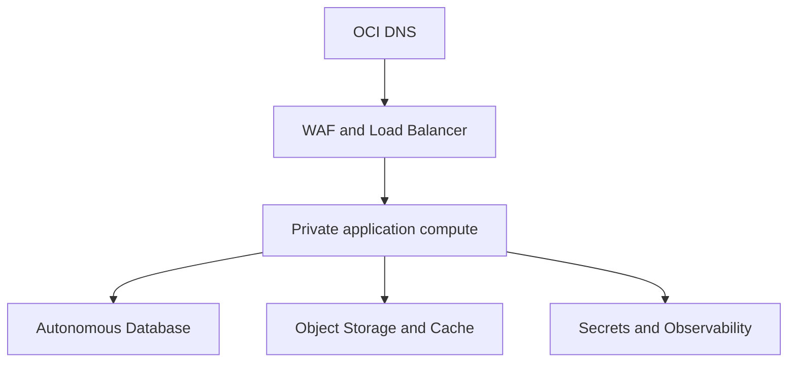

# Oracle Cloud target infrastructure

## Status

This document defines the approved final OCI architecture. The repository does not yet contain the complete Oracle schema, infrastructure as code, OCI service adapters, or verified production images.

## Goals

- Run all production application workloads on Oracle Cloud Infrastructure.
- Use managed OCI services for data, objects, cache, secrets, ingress, registry, and observability.
- Support both storefronts, the shared seller portal, admin panel, and API without duplicating the platform.
- Keep environments reproducible through infrastructure as code.
- Support ARM64 images when Ampere compute is selected.
- Apply least privilege, private networking, encryption, and auditable changes.

## Target service map

| Capability | OCI target |
| --- | --- |
| DNS | OCI DNS |
| Edge protection | OCI Web Application Firewall |
| TLS and routing | OCI Load Balancer and OCI Certificates |
| Application compute | OCI Compute, preferably Ampere A1 where capacity and workload support are verified |
| Container images | Oracle Cloud Infrastructure Registry (OCIR) |
| Transactional data | Autonomous Database for transaction processing |
| Cache/coordination | OCI Cache with Redis/Valkey-compatible client abstraction |
| Media and exports | OCI Object Storage |
| Secrets and keys | OCI Secret Management and Vault/KMS capabilities |
| Logs and metrics | OCI Logging, Monitoring, Alarms, Notifications, and Audit |
| Infrastructure state | Approved remote encrypted state with locking; never in source control |

## Logical topology

## Environment model

Use separate `dev`, `staging`, and `production` environments. Production should be isolated in dedicated compartments and policies. Shared tenancy-level resources must have explicit ownership.

Every environment has:

- Its own storefront domains or safe non-production subdomains.
- Separate database, cache, buckets, secrets, payment test/live accounts, and logs.
- Independent deployment configuration and service identities.
- No automatic path from development credentials to production resources.

Production payment credentials are never available in preview environments.

## Network design

- Create a VCN with public subnets only for internet-facing load balancers and private subnets for application/data access.
- Use network security groups with the minimum required ports and sources.
- Application compute accepts public traffic only from the load balancer.
- Administrative access uses an approved bastion/session mechanism; do not expose SSH broadly.
- Prefer service gateways/private endpoints for OCI services when supported.
- Control egress and document any external payment, email, OAuth, or shipping endpoints required.
- Preserve and validate trusted proxy headers at the API.

## Compute and container delivery

- Build immutable multi-stage images for each deployable web application and FastAPI.
- Pin base images by supported version and scan them before release.
- Build and test for the actual target architecture, including `linux/arm64` when Ampere is used.
- Push versioned images to OCIR; never deploy mutable source worktrees directly.
- Run processes as non-root, use read-only filesystems where practical, and expose explicit health/readiness endpoints.
- Keep runtime configuration outside images.
- Use rolling or blue/green deployment with health gates once production deployment is introduced.

## Autonomous Database

Oracle is the target system of record for identity, catalog, listings, inventory, carts, checkouts, orders, payments, refunds, shipments, rewards, and audit metadata.

Requirements:

- Versioned schema migrations with one authoritative migration history.
- Connection pooling appropriate for FastAPI worker count and Autonomous Database limits.
- Transaction boundaries for inventory reservations, order creation, and financial state.
- Fixed-precision money constraints and indexed storefront scoping.
- Least-privilege application schemas/users; migration credentials separated from runtime credentials.
- Encryption in transit using wallet or supported TLS configuration.
- Tested restore and recovery procedures before accepting live orders.

The project can start with a fresh Oracle dataset; no legacy production backup is required for initial development. This does not remove the requirement for automated backups and restore testing once production data exists.

## Object Storage

Use private buckets by default. Store product media, reel media, avatars, generated exports, and safe provider payload archives under purpose-specific prefixes or buckets.

- Generate short-lived pre-authenticated/signed upload and download operations through the backend.
- Validate MIME type, extension, size, ownership, and malware policy.
- Store object keys and metadata in Oracle; avoid coupling business records to public provider URLs.
- Define lifecycle and retention policies for temporary uploads and logs.
- Serve public media through an approved CDN/cache path without making upload credentials public.

## Cache

Cache is never the sole source of truth for orders, payments, inventory, users, or permissions. Appropriate uses include rate limits, short-lived computed catalog data, distributed locks with bounded safety, and session-related ephemeral state.

- Namespace keys by environment and purpose.
- Assign expirations deliberately.
- Design cache miss and cache loss behavior.
- Avoid storing payment secrets or full personal records.

## Secrets and workload identity

- Store database credentials, session keys, OAuth secrets, payment keys, webhook secrets, email credentials, and shipping credentials in OCI secret services.
- Reference secrets by stable identifier; do not copy values into Terraform variables, image layers, logs, or database rows.
- Prefer dynamic groups and instance/resource principals for OCI API access.
- Rotate keys with version-aware application behavior.
- Separate storefront payment secrets and restrict access to the payment runtime.

## Observability

All services emit structured logs with environment, service, version, request/correlation ID, and storefront ID when applicable. Never log OTPs, passwords, tokens, card data, raw webhook secrets, or unnecessary personal information.

Minimum production signals:

- Request rate, latency, and error rate by service and route group.
- Database pool saturation, slow queries, and failed transactions.
- Checkout conversion and order-creation failures by storefront.
- Payment initiation, webhook delay, failure, refund, and reconciliation exceptions by account.
- Inventory reservation conflicts.
- Shipping booking and webhook failures.
- Object upload failures and suspicious volume.
- Certificate expiration, unhealthy backends, compute pressure, and deployment failures.

Critical alarms route through OCI Notifications to an owned response channel.

## Infrastructure as code

Terraform or an approved OCI-native equivalent should define compartments, networking, policies, compute, registry integration, database, buckets, cache, load balancer, WAF, DNS, certificates, secrets metadata, logging, monitoring, and alarms.

- Keep environment values separate from reusable modules.
- Pin provider/module versions.
- Review plans before apply.
- Prevent secrets and private state from entering Git.
- Apply through a controlled CI identity when that workflow is authorized.
- Detect and resolve drift rather than making undocumented console changes.

## Migration sequence

1. Define the target schema and provider-neutral storage/cache/secret interfaces.
2. Establish OCI compartments, networking, registry, identity policies, and non-production services.
3. Make application images deterministic and validate ARM64 builds.
4. Create Oracle migrations and seed storefront configuration.
5. Move data ownership module by module with reconciliation checks.
6. Move media to Object Storage and runtime secrets to OCI.
7. Deploy staging behind non-production domains and execute end-to-end tests.
8. Configure production domains, WAF, alarms, payment webhooks, and runbooks.
9. Cut over one controlled surface at a time and keep a tested rollback path.

## Production gate

Do not accept live orders until TLS, WAF policy, exact CORS, secure sessions, server-side totals, storefront isolation, payment signature verification, idempotency, database recovery, secret rotation, alarms, ARM64/runtime compatibility, and deployment rollback have all been tested in staging.

Phase 4 establishes application-side Oracle metadata and migrations only. No Autonomous Database, OCI network, Vault, backup, restore, or production schema has been provisioned or tested.

Phase 5 validated migration 0001 on local Oracle Database 23ai Free 23.9 without emulation. That evidence does not prove Autonomous Database service version, restricted privileges, TLS/wallet connectivity, resource limits, private networking, backup/restore, or OCI operations; those require a separately authorized disposable OCI environment.
