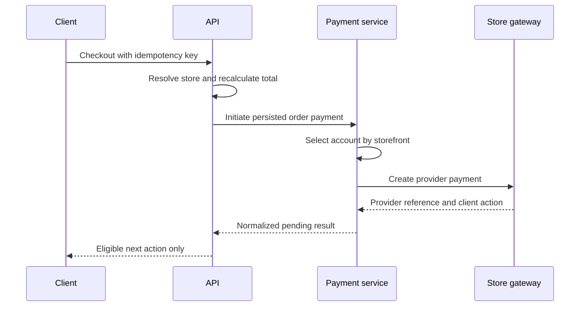

# Payment architecture

## Decision

Zolexora Shop and Mahila Madel use separate payment gateway configurations or merchant accounts. They share one payment orchestration module, lifecycle model, and operational tooling.

The exact provider assigned to each storefront is configuration, not hard-coded business logic. A production provider/account decision must be recorded before live credentials are provisioned.

## Current state

The FastAPI backend currently has one global Razorpay key pair and one UPI merchant configuration. Checkout accepts a client-supplied `payment_method`, creates Razorpay orders, verifies a browser-return signature, or accepts a UPI reference for manual verification. There is no complete provider-neutral abstraction, payment webhook lifecycle, refund orchestration, merchant-account model, or reconciliation process.

The Mahila Madel application currently exposes payment choices in the UI but does not implement a production-grade gateway. Its server accepts client-provided order totals. These are migration blockers, not patterns to retain.

## Trust boundary

The payment account is selected from persisted trusted data:

1. The customer host resolves to a trusted storefront.
2. The cart and checkout are bound to that storefront.
3. The server recalculates the total and creates the order with immutable `storefront_id`.
4. Payment orchestration loads the active payment account for that storefront and environment.
5. The provider adapter creates the payment request.

The client may choose only among eligible **payment methods** returned by the server, such as card, UPI, or COD. It cannot provide a provider name, merchant ID, account key, amount, currency, callback truth, or storefront override.

## Components

| Component | Responsibility |
| --- | --- |
| Payment account registry | Maps storefront and environment to an active provider account and secret references |
| Payment service | Validates order state, amount, currency, and idempotency; coordinates adapter calls |
| Provider adapter | Translates internal operations to a specific gateway SDK/API |
| Webhook ingress | Identifies account, verifies signature, deduplicates, and persists event |
| Payment state machine | Applies allowed transitions to attempts and orders |
| Refund service | Validates refundable balance and coordinates provider refunds |
| Reconciliation worker | Compares internal captures/refunds with provider records and settlements |
| Admin operations | Displays failures and controlled actions without exposing secrets |

## Provider adapter contract

An adapter should support capabilities explicitly rather than pretending all gateways are identical.

```text
create_payment(request, idempotency_key)
fetch_payment(provider_payment_id)
capture_payment(provider_payment_id, amount)
cancel_payment(provider_payment_id)
create_refund(provider_payment_id, amount, idempotency_key)
fetch_refund(provider_refund_id)
verify_webhook(headers, raw_body, account_config)
normalize_event(verified_event)
```

Adapters return normalized internal results and safe provider references. Domain services must not import provider SDKs directly.

## Payment state

Keep payment state separate from fulfillment state.

Suggested payment-attempt states:

- `created`
- `pending_customer`
- `authorized`
- `captured`
- `failed`
- `cancelled`
- `expired`
- `partially_refunded`
- `refunded`

Provider events can arrive late, twice, or out of order. Transition logic compares event time/provider sequence and current state, stores every verified event once, and makes duplicate delivery a no-op.

An order becomes paid only from authoritative provider verification or an approved offline-payment workflow—not from a client redirect or arbitrary “paid” request.

## Initiation flow



## Webhooks

Webhooks are the primary asynchronous truth for capture, failure, refund, and dispute events when the provider supports them.

- Use the raw request body for signature verification.
- Resolve the expected secret from endpoint key or persisted provider object, not a request storefront header.
- Reject unconfigured, unsigned, stale, or invalid events.
- Persist provider event ID and a payload hash before applying business effects.
- Enforce uniqueness on payment account plus provider event ID.
- Return a success response for previously processed valid duplicates.
- Process retries safely and expose dead-letter/review state.
- Log correlation and normalized status, never credentials or sensitive payment details.

## Idempotency

Require idempotency keys for checkout, payment initiation, capture, cancellation, and refund mutations.

An idempotency record includes actor/scope, operation, normalized request hash, result reference, status, and expiry policy. Reusing a key with a different request is rejected. Concurrent requests for the same key yield one operation.

Provider idempotency features should be used in addition to—not instead of—internal protection.

## Amount integrity

- Price, discount, coins, tax, shipping, and total are calculated on the server.
- The payment amount and currency must match the persisted order/checkout snapshot.
- Use integer paise for INR or a rigorously enforced fixed-precision convention.
- Validate capture and refund amounts against the provider response.
- Never trust client line items or Mahila's current client-submitted totals.
- A price change before initiation creates a refreshed quote and requires customer confirmation.

## Refunds

Refunds are independent records with their own state and idempotency key.

- Verify actor permission and refundable balance.
- Support partial refunds if the chosen provider/account supports them.
- Do not mark a refund complete until provider confirmation is authoritative.
- Link refund reason to order items or operational reason where applicable.
- Inventory/return handling is coordinated but not hidden inside the provider adapter.
- Store all admin refund actions in the audit log.

## Reconciliation

At least daily in production:

- Fetch or import provider payments, captures, refunds, fees, and settlements per merchant account.
- Match by account and provider reference.
- Compare amount, currency, state, and timestamps.
- Flag missing webhooks, unmatched records, duplicate captures, and refund discrepancies.
- Provide store-specific and provider-specific exception views.
- Resolve discrepancies through auditable actions, not direct database edits.

## Secrets and environments

- Each storefront has separate test and live payment-account records.
- Secret values live in OCI Secret Management and are loaded only by authorized payment workloads.
- The browser receives only provider-safe publishable identifiers needed for the current initiated payment.
- Test and live identifiers cannot be mixed.
- Rotation supports overlapping secret versions when a provider/webhook requires it.
- No secret, signed payload, OTP, full card data, or access token is logged.

## COD and manual UPI

COD is an order payment method with eligibility and shipping rules; it still requires server-side totals and an auditable state. Manual UPI reference verification may exist temporarily, but it must be storefront-scoped, duplicate-safe, permission-controlled, and clearly marked for operator review. It is not a replacement for provider verification.

## Required tests

- Each storefront routes to only its configured test account.
- Spoofed store/provider/body fields cannot change routing.
- Amount and currency come from the persisted server quote.
- Duplicate initiation returns the existing attempt.
- Valid, invalid, duplicated, delayed, and out-of-order webhooks behave safely.
- One storefront's secret cannot validate another storefront's event.
- Capture, partial refund, full refund, and failed refund transitions are constrained.
- Reconciliation detects missing and mismatched provider records.
- Logs and API responses contain no secrets or sensitive payment data.

## Go-live gate

For both storefronts, complete sandbox end-to-end checkout, authoritative webhook verification, idempotency tests, refund tests, reconciliation dry run, credential isolation, audit logging, alerting, and an operational incident runbook before enabling live payments.

