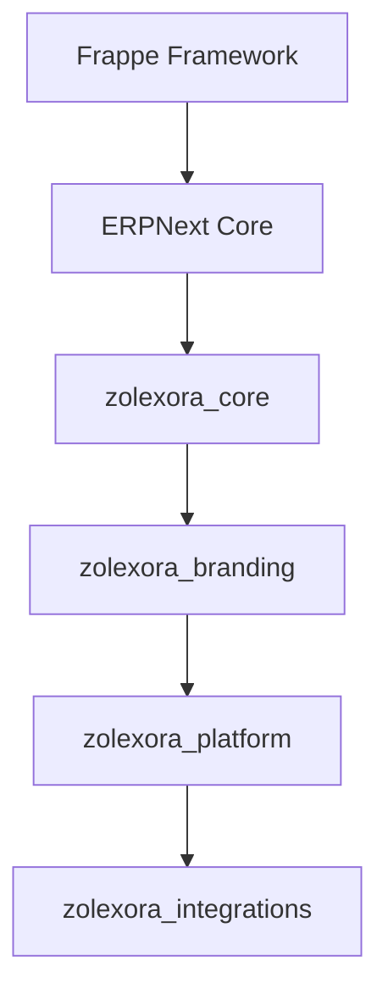

# Zolexora ERP Architecture Guide

This document describes the enterprise-grade, modular, upgrade-safe architecture of the Zolexora ERP platform.

---

## 1. Overview

Zolexora ERP is built on the Frappe framework and ERPNext v16. It leverages a multi-app architecture to extend core systems without altering standard files, maintaining 100% upgrade compatibility.

---

## 2. Multi-App Separation

To achieve maximum scalability and modularity, custom features are divided into four distinct applications:

### A. Zolexora Core (`zolexora_core`)
- **Purpose:** Core business logic, setup scripts, base database tables, default roles, custom permissions, and foundational REST APIs.
- **Dependencies:** `erpnext`
- **Key Modules:** Accounts, Inventory, Sales, Purchase, CRM, HR, Administration.
- **Key Features:** User authentication validation, bin-based real stock checking.

### B. Zolexora Branding (`zolexora_branding`)
- **Purpose:** Whitelabeling the system. Isolates all styles, javascript hooks, corporate assets, and templates.
- **Dependencies:** `zolexora_core`
- **Key Features:** Custom login theme, logo, favicon, dark mode toggling, navigation styling, customized browser titles.

### C. Zolexora Platform (`zolexora_platform`)
- **Purpose:** Complex domain services, including logistics routing, fleet tracking, manufacturing queues, and predictive AI analytics.
- **Dependencies:** `zolexora_branding`
- **Key Modules:** Fleet, Logistics, Manufacturing, AI, Analytics.

### D. Zolexora Integrations (`zolexora_integrations`)
- **Purpose:** Integration with third-party marketplaces, payment gateways, background syncing crons, and notification routing engines (Email/SMS).
- **Dependencies:** `zolexora_platform`

---

## 3. Infrastructure & Deployment Architecture

The platform runs on a Docker-based architecture defined by `compose.yaml`.

- **Web Request Pipeline:** User -> Nginx -> backend (bench start) / socketio (bench socketio).
- **Background Task Execution:** Scheduler -> Redis Cache/Queue -> Workers.
- **Database System:** MariaDB (relational data).
- **Caching & Messaging:** Redis Cache (runtime caching), Redis Queue (asynchronous queues), Redis SocketIO (WebSockets).

Persistent volumes are mapped for sites, assets, database, and backups to ensure zero data loss during container updates.
