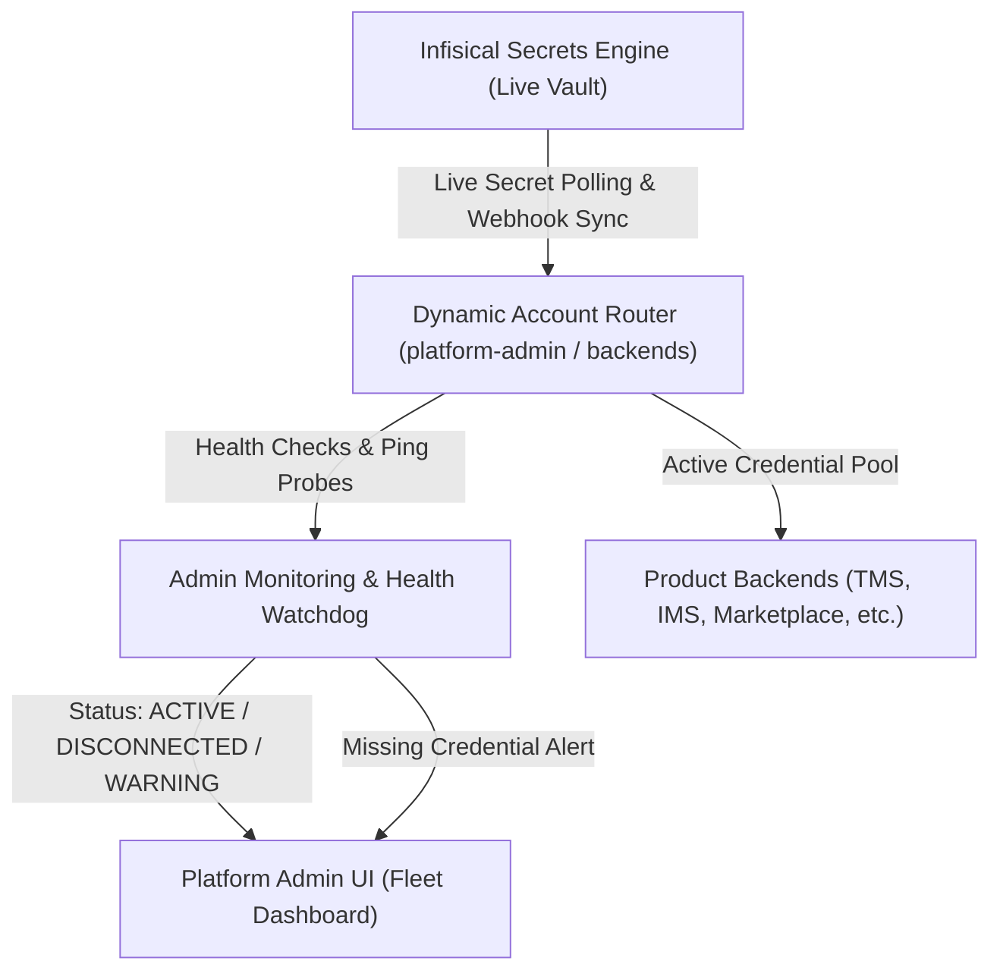

# 13 Dynamic Account Router & Admin Monitoring Architecture

## 1. Overview & Core Philosophy

The Zolexora Platform relies on distributed cloud resources across multiple providers (Firebase, Cloudflare, Supabase, MongoDB Atlas). To avoid vendor lock-in, hardcoded quotas, and account creation maintenance bottlenecks, this system enforces four architectural principles:

1. **No Fixed Account Count:** The system never assumes a hardcoded number of accounts (e.g., 20 Firebase accounts or 39 Cloudflare accounts). The cluster dynamically expands ($N+1$) or contracts ($N-1$) at runtime.
2. **Infisical as the Single Source of Truth:** All active credentials, API keys, and service tokens are pulled live from Infisical. If a credential exists in Infisical and passes health checks, it is **Active**. If removed or expired, it is **Disconnected**.
3. **No Account Creation Feature:** The Platform Admin Panel and backend routers **never** attempt to create Google, Firebase, or cloud accounts programmatically (which violates ToS and triggers CAPTCHA/bot fraud blocks). Accounts are provisioned manually by human admins, and credentials are simply registered into Infisical.
4. **Instant Missing Credential Alerting:** If any product or service lacks an assigned credential or health check fails, the router immediately surfaces a high-priority diagnostic message in the Admin Panel and sends a notification.

---

## 2. Dynamic Router Architecture



### 2.1 The Dynamic Account Lifecycle

* **Discovery:** The Router scans Infisical namespace paths (e.g. `/shared/firebase/accounts/*` or `/platform-admin/clusters/*`).
* **Validation & Odd/Even Sharding:**
  * Validates token format, issuer, and connectivity with provider JWKS/APIs.
  * Disconnected/invalid accounts are quarantined with an alert without crashing active services.
* **Traffic Routing:**
  * Product traffic is routed across active accounts based on configured product bindings.
  * If an account hits 90% of its monthly free quota (e.g. 9,000 / 10,000 Phone OTPs), the router flags it as **QUOTA_THROTTLED** and switches new requests to the next available active account in that cluster.

---

## 3. Real-Time Admin Monitoring & Fleet Dashboard

The Next.js `platform-admin` frontend features a dedicated **Account Management & Router Monitor**:

### 3.1 Capabilities

1. **Dynamic Fleet Grid:**
   * Lists every discovered account by Provider, Alias, Project ID, Status (`ACTIVE`, `DEGRADED`, `DISCONNECTED`).
   * Displays live metrics: Remaining monthly OTPs, storage used (GB), API requests today, and latency.
2. **Missing Credential Diagnostics:**
   * If a product (e.g. `zolexora-engage`) does not have an active credentials record in Infisical, the dashboard displays:
     > ⚠️ **Configuration Alert:** `zolexora-engage` has no active Firebase/Database binding in Infisical (`/zolexora-engage`). Defaulting to fallback sandbox mode.
3. **One-Click Manual Disconnect / Re-Sync:**
   * Admins can trigger **Re-sync from Infisical** without restarting backend containers.
   * Admins can temporarily toggle an account to **DRAINING** or **DISCONNECTED** for maintenance.

---

## 4. Error & Alert Messaging Protocol

Whenever a credential is missing or rejected:

```json
{
  "event": "ROUTER_CREDENTIAL_MISSING",
  "severity": "CRITICAL",
  "provider": "firebase",
  "target_product": "zolexora-tms",
  "expected_secret": "FIREBASE_PROJECT_ID",
  "infisical_path": "/zolexora-tms/FIREBASE_PROJECT_ID",
  "message": "Missing live credential for Zolexora TMS. Please set FIREBASE_PROJECT_ID and associated keys in Infisical.",
  "timestamp": "2026-10-13T11:50:00Z"
}
```

This alert is piped to:
1. Platform Admin Banner UI (`/admin/clusters/health`)
2. Discord/Telegram Webhook (`.github/scripts/notify.py`)
3. FastAPI Structured Logger
