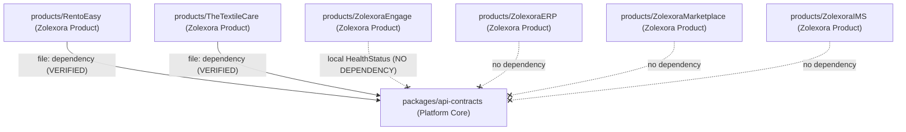

# Repository Boundaries and Architecture Reconciliation

## 1. Executive Summary & Critical Product Classification
This document establishes the verified architectural boundaries of the `Zolexora_Platform` monorepo following the Phase F/G audit.

### First-Class Zolexora Products
The following ten products are all first-class products of the Zolexora ecosystem, residing under `products/`:
1. **ZolexoraERP** (`products/ZolexoraERP`)
2. **ZolexoraMarketplace** (`products/ZolexoraMarketplace`)
3. **ZolexoraTMS** (`products/ZolexoraTMS`)
4. **ZolexoraIMS** (`products/ZolexoraIMS`)
5. **ZolexoraAI** (`products/ZolexoraAI`)
6. **ZolexoraEngage** (`products/ZolexoraEngage`)
7. **RentoEasy** (`products/RentoEasy`)
8. **TheTextileCare** (`products/TheTextileCare`)
9. **ClarityFi** (`products/ClarityFi`)
10. **MaunKavach** (`products/MaunKavach`)

> **Product Ownership & Autonomy Rules:**
> * `RentoEasy`, `TheTextileCare`, and `ZolexoraEngage` are core Zolexora products—they are **NOT** customer-specific solutions or third-party add-ons.
> * "Product-local" strictly describes **code ownership and package scoping** (e.g., code maintained inside a product workspace for that product's specific business domain). It does **NOT** mean the product is external to Zolexora.
> * Every Zolexora product operates as an autonomous, self-contained workspace with its own dependencies, internal packages, and lifecycle.

---

## 2. Actual Root Structure
Verification against the live filesystem:
* `packages/`: Global Platform Core capabilities shared across products.
  * `packages/api-contracts/`: Neutral, dependency-free TypeScript interfaces (`ApiResponse`, `PaginatedResponse`, `ApiError`, `HealthStatus`).
* `products/`: First-class autonomous Zolexora product workspaces.
* `infrastructure/`: Operational, container, database, cloud, and host deployment specifications centralized by concern:
  * `cloud/`: Cloud platform and PaaS manifests (`render.yaml`).
  * `containers/`: Platform container builds (`docker/`), Compose stacks (`compose/`), and Nginx configs (`nginx/`).
  * `database/`: Centralized database schemas and migrations.
  * `deployment/`: Production host orchestration, diagnostic doctor, installer, and disaster recovery framework (`ZolexoraDeployment`).
  * `supabase/`: Centralized Supabase platform configuration and migrations.
* `configs/`: Global environment configurations.
* `docs/`: Monorepo architecture and operational documentation.
* `scripts/`: Platform management and automation scripts.
* `storage/`: Runtime backup staging, logs, and product asset storage (ignored from Git tracking).

> **Note on "Rice Images":** `Rice Images` is NOT a root-level directory. It consists of sample storefront product image assets for ZolexoraMarketplace (`storage/ZolexoraMarketplace/Rice Images/` / `products/ZolexoraMarketplace/apps/storefronts/zolexora-shop/web/public/`).
> **Note on Root "platform/":** There is no root-level `platform/` directory. Platform Core capabilities reside under `packages/`.

---

## 3. Classification of "packages/" Directories

| Path | Owner | Consumers | Purpose | Platform vs. Product | Move Required? | Rationale |
|---|---|---|---|---|---|---|
| `packages/api-contracts` | Platform Core | `RentoEasy`, `TheTextileCare` | Neutral API response schemas & types | **Platform Shared** | **No** | Approved cross-product contract. |
| `products/ClarityFi/packages/` | ClarityFi | Internal (`apps/*`, `tools/*`) | Product API clients, Zod schemas, DB models | **Product-Local** | **No** | Contains domain models strictly for ClarityFi. |
| `products/RentoEasy/packages/` | RentoEasy | Internal (`apps/*`, `services/*`) | Shared types (`@rent-stay/types`) & utils | **Product-Local** | **No** | Re-exports platform contracts alongside product types. |
| `products/TheTextileCare/packages/` | TheTextileCare | Internal (`apps/*`) | TTC UI, tenant, branding, auth, types | **Product-Local** | **No** | Product-specific library workspace. |
| `products/ZolexoraMarketplace/packages/` | ZolexoraMarketplace | Internal (`apps/*`) | `@zolexora/shared-api`, `@zolexora/shared-config` | **Product-Local** | **No** | Marketplace frontend/portal shared client libraries. |

---

## 4. Classification of Product-Local "platform/" Directory
* **Path:** `products/TheTextileCare/platform/`
* **Components:** `app-factory/`, `customization/`, `white-label/` (each currently containing only architectural READMEs).
* **Owner:** TheTextileCare (Zolexora Product)
* **Classification:** **Product-Local Scaffolding**.
* **Decision:** Retain within `products/TheTextileCare/platform/`. Do NOT move to root `platform/`. These modules represent product-specific white-label tenant features, not global platform infrastructure.

---

## 5. Classification of Product Contracts
* **Path:** `products/ZolexoraMarketplace/contracts/`
* **Components:**
  * `marketplace/openapi.json`: Marketplace public API contract.
  * `zolexora-erp/v1/`: Proposed schemas and payloads for Marketplace integration with ERP (sales order, inventory balance, delivery update).
* **Owner:** ZolexoraMarketplace (Zolexora Product)
* **Classification:** **Product-Specific Contracts**.
* **Decision:** Retain within Marketplace. These schemas reflect the integration interface expected by Marketplace from the ERP, not global platform-wide contracts.

---

## 6. Classification of Backend-Shared Code
* **Path:** `products/ZolexoraIMS/backend-shared/`
* **Components:** `security.py`, `utils.py`, `logging.py`
* **Owner:** ZolexoraIMS (Zolexora Product)
* **Consumers:** `products/ZolexoraIMS/apps/ims-user/backend/`
* **Classification:** **Product-Local Shared Backend**.
* **Decision:** Retain within ZolexoraIMS. Despite the name "backend-shared", it is exclusively consumed by IMS internal backend services.

---

## 7. Classification of Infrastructure & Canonical Deployment Path
* **Canonical Deployment Path:** `infrastructure/deployment/`
* **Owner:** Platform Infrastructure Operations
* **Purpose:** Host provisioning, firewall configuration, Nginx reverse proxy management, Let's Encrypt TLS automation, systemd services, and operational health probes (`doctor.sh`, `install.sh`).
* **Classification:** **Repository-Wide Production Host Infrastructure**.
* **Decision:** Retain under `infrastructure/deployment/`. The legacy symlink/path `infrastructure/ZolexoraDeployment` has been permanently removed.

---

## 8. Classification of Storage & Runtime Backups
* **Path:** `storage/` (`storage/backups/`, `storage/logs/`, `storage/exports/`, `storage/temporary/`)
* **Tracking:** Excluded from Git via `.gitignore` (`storage/backups/`, `storage/logs/`, etc.).
* **Usage:** Mounted by Docker Compose (`compose.yaml`) for database backups and operational logging.
* **Decision:** Runtime only; must never be committed to source control.

---

## 9. Platform Core vs. ERP Boundary
* **ERP Boundary:** `products/ZolexoraERP/backend/`
  * Contains `zolexora_core`, `zolexora_platform`, `zolexora_branding`, and `zolexora_integrations`.
  * These are Frappe Python applications extending ERPNext (version-16).
  * **Rule:** These modules remain inside `products/ZolexoraERP/backend/`. They are domain-specific to the ERP monolith and must not be conflated with the TypeScript Platform Core under `packages/`.

---

## 10. Dependency Matrix & Consumer Status

### Architectural Dependency Rules
1. `Product A` **MUST NOT** import from `Product B` internals.
2. `packages/api-contracts` **MUST NOT** depend on any product.
3. Verified consumers (`RentoEasy`, `TheTextileCare`) consume `packages/api-contracts` via `file:../../../../packages/api-contracts` in their local `package.json` while maintaining isolated `pnpm-workspace.yaml` boundaries.
4. Turborepo requires that `pnpm-workspace.yaml` does not declare parent paths (`../../packages/*`); the `file:` dependency protocol respects this workspace isolation.
