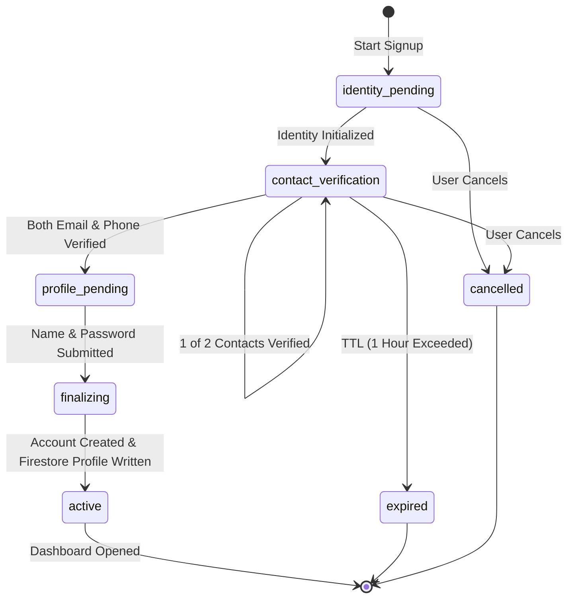

# Unified Firebase Authentication Architecture Guide

**Version:** 2.0.0  
**Target Platforms:** Web (React + Vite), iPhone (Native iOS / SwiftUI), Android (Native Kotlin / Jetpack Compose)  
**Authority:** Firebase Authentication (Sole Identity Provider)

---

## 1. Executive Summary & Core Rules

1. **Sole Authentication Authority:** Firebase Authentication is the single, authoritative identity provider across all Zolexora applications and platforms. Supabase is strictly eliminated as an auth provider.
2. **Canonical Identity:** Each individual user resolves to a single Firebase Authentication `uid`. Firestore maintains user profile metadata in `users/{uid}`, where `uid` matches the Firebase Auth UID.
3. **Canonical Zolexora ID:** Every active user receives a deterministic, non-ambiguous identifier formatted as `ZX-XXXX-XXXX-XXXX` (Base32, excluding 0, O, 1, I). Organizations use `ZX-ORG-XXXX-XXXX-XXXX`.
4. **Mandatory Dual Verification on Signup:**
   - All signup flows require **both** verified email and verified mobile phone number before an account is finalized.
   - Normal login for established accounts requires only the chosen credential (e.g. Email + Password, Mobile + Password, or Google OAuth) without re-prompting for signup OTPs.
5. **No Client Privilege Escalation:**
   - Clients cannot self-verify phone or email (`phoneVerified`, `emailVerified` are managed exclusively by the trusted backend).
   - Clients cannot mark onboarding complete (`onboarding_completed: true` is strictly enforced by the backend and guarded by Firestore Security Rules).

---

## 2. Authentication Entry Screen (Three-Option Model)

All platforms present three consistent, unified options:

```
┌────────────────────────────────────────────────────────┐
│              Zolexora Platform Identity                │
│          Unified Multi-Platform Access                 │
├────────────────────────────────────────────────────────┤
│  [ G ] Continue with Google                            │
│  [ ✉ ] Continue with Email                             │
│  [ ☎ ] Continue with Mobile Number                     │
└────────────────────────────────────────────────────────┘
```

### Platform-Specific Binding

| Platform | Google Sign-In | Phone Verification | Email Verification |
| :--- | :--- | :--- | :--- |
| **Web Browser** | Firebase Web SDK `signInWithPopup` / `signInWithRedirect` | Firebase Phone Auth (reCAPTCHA + SMS OTP) | Custom Email OTP Challenge via Trusted Backend |
| **Native Android** | Google Credential Manager + `GoogleAuthProvider` | **Firebase PNV (Carrier-backed)** first; automatic fallback to `PhoneAuthProvider` SMS OTP | Custom Email OTP Challenge via Trusted Backend |
| **Native iOS** | GoogleSignIn Swift SDK + `GoogleAuthProvider` | Firebase iOS SDK `PhoneAuthProvider` (APNs silent notification + SMS OTP) | Custom Email OTP Challenge via Trusted Backend |

Mobile browsers always execute the **Web** flow. Android-only PNV APIs are never exposed to browser runtimes.

---

## 3. Registration State Machine

Registration follows an explicit, unidirectional state machine:



### State Definitions

1. `identity_pending`: Initial session creation in `registrationAttempts/{attemptId}`.
2. `contact_verification`: User completes verification for their contact channels:
   - Google signup: Email pre-verified by Google; phone number requested and verified.
   - Email signup: Email verified via custom 6-digit OTP challenge; mobile number requested and verified.
   - Mobile signup: Phone verified via PNV / SMS OTP; email requested and verified via custom OTP challenge.
3. `profile_pending`: Both email and phone are cryptographically verified. User enters display name and application password.
4. `finalizing`: Backend atomically links identities, initializes the `users/{uid}` document, and generates the canonical Zolexora ID.
5. `active`: Registration complete. Custom token issued, user enters Dashboard.
6. `expired`: Attempt exceeds 1-hour TTL.
7. `cancelled`: Registration aborted by user.

---

## 4. Android Phone Verification (Firebase PNV)

On compatible native Android devices, **Firebase Phone Number Verification (PNV)** is the preferred method:

1. **Eligibility Check:** The Android client checks for physical SIM readiness (`TelephonyManager.SIM_STATE_READY`) and cellular network connectivity.
2. **Carrier Assertion:** The client requests a carrier-backed assertion token.
3. **Trusted Verification:** The token is sent to the backend `/registration/pnv/verify`.
4. **Fallback Mechanism:**
   - If the device is on Wi-Fi without active cellular data, lacks a supported carrier, or if the user cancels, the system automatically transitions to standard **Firebase Authentication SMS OTP** (`PhoneAuthProvider.verifyPhoneNumber()`).
   - The user experience is uninterrupted and safe across all devices.

---

## 5. Custom Email Challenge (Email OTP)

Because Firebase Authentication email/password does not provide a native arbitrary 6-digit numeric OTP signup API, Zolexora implements a trusted, cryptographically secure challenge:

1. **Generation:** Backend generates a secure 6-digit OTP (`crypto.randomInt(100000, 1000000)`).
2. **Hashing:** The OTP is combined with a random 16-byte salt and hashed with SHA-256 (`crypto.createHash('sha256')`).
3. **Storage:** Only the hash, salt, expiration (10 minutes), and attempt counter (max 5 tries) are stored in Firestore `registrationAttempts/{attemptId}`. Raw OTPs are never stored.
4. **Delivery:** The OTP is dispatched via Resend API (`auth@zolexora.com`).
5. **Verification:** The client submits the 6-digit OTP; the backend compares hashes using constant-time comparison (`crypto.timingSafeEqual`) to prevent timing attacks.

---

## 6. Login & Password Flows

### Google Login
- Authenticates with Google credential.
- Resolves Firebase Auth UID.
- If Firestore profile `users/{uid}` has `onboarding_completed: true`, user enters Dashboard.
- If incomplete, resumes the pending registration attempt.

### Email Login
- User provides email and application password.
- Authenticates directly via `signInWithEmailAndPassword`.
- Enters Dashboard immediately (no OTP required during normal login).

### Mobile Login
- User provides mobile number and application password.
- Authenticates via `/login/mobile-password`.
- Backend verifies account credentials and returns a secure Firebase custom token.
- Enters Dashboard immediately.

### Password Recovery
- Standard password recovery is supported via `sendPasswordResetEmail(email)`.
- For Google-first accounts that wish to add a password, `/account/setup-password` allows setting an application password once the user is authenticated.

---

## 7. Data Model & Firestore Security Rules

### Collections

#### `users/{uid}`
- `uid`: String (Firebase Auth UID, immutable)
- `zolexora_id`: String (`ZX-XXXX-XXXX-XXXX`, immutable)
- `email`: String (email address)
- `phone_number`: String (E.164 phone number)
- `display_name`: String (max 100 chars)
- `photo_url`: String (optional, max 500 chars)
- `email_verified`: Boolean
- `phone_verified`: Boolean (trusted, cannot be modified by client)
- `onboarding_completed`: Boolean (trusted, cannot be modified by client)
- `status`: String (`"active" | "suspended"`)
- `created_at`: String (ISO 8601)
- `updated_at`: String (ISO 8601)

#### `registrationAttempts/{attemptId}`
- `attemptId`: String (unique identifier)
- `uid`: String (optional, bound user UID)
- `signupMethod`: String (`"google" | "email" | "mobile"`)
- `platform`: String (`"web" | "android" | "ios"`)
- `status`: String (`"identity_pending" | "contact_verification" | "profile_pending" | "finalizing" | "active"`)
- `emailVerified`: Boolean (trusted, set by backend)
- `phoneVerified`: Boolean (trusted, set by backend)
- `emailOtpHash`: String (backend only)
- `expiresAt`: String (ISO 8601, max 1 hour from creation)

#### `securityEvents/{eventId}`
- `eventId`: String (unique identifier)
- `eventType`: String (`signup_started`, `signup_completed`, `login_success`, etc.)
- `platform`: String (`"web" | "android" | "ios"`)
- `uid`: String (optional)
- `timestamp`: String (ISO 8601)
- `metadata`: Map (safe diagnostic metadata)

### Firestore Security Rules Audit Summary

Our rules in `firestore.rules` achieved **Score 5 (Secure)** against the `firebase-security-rules-auditor` checklist:
- **Strict Ownership:** `isOwner(userId)` enforces `request.auth.uid == userId`.
- **Anti-Escalation:** Client updates cannot alter `onboarding_completed`, `phone_verified`, `status`, or `role`.
- **DoS Protection:** Explicit string size limits enforced on all fields (`size() <= 100`, `size() <= 30`, etc.).
- **Type Safety:** All fields validated for primitive types (`is string`, `is bool`).
- **Audit Immutability:** `securityEvents` is append-only for allowed events; update and delete operations are forbidden.
